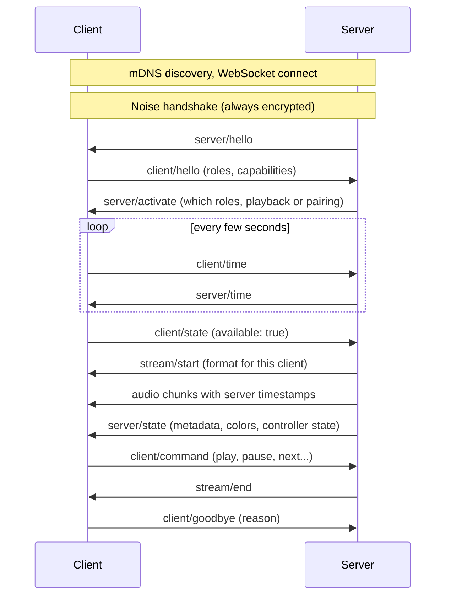

本章介绍客户端、服务器以及它们之间的连接。每一节的末尾都有一个链接，指向[规范](/build/spec/)中定义相关内容的部分。

## 客户端与服务器

**客户端（client）**是网络上的一个端点。它从服务器接收音频；如果具备源（source）角色，则采集音频并交给服务器。客户端可以是一个扬声器、功放、流媒体播放器、壁挂显示屏、灯具、浏览器标签页，也可以是树莓派（Raspberry Pi）上的 CLI 播放器。

**服务器（server）**决定在哪里播放什么内容，为每个客户端编码一条流，让所有客户端保持同一时间线，并管理组、音量和元数据。服务器是唯一进行音频混音、重采样或转码的地方。Music Assistant 就是一个服务器。把正在播放的音乐串流到房间内音箱的手机应用也是服务器。

**角色（role）**是客户端选择加入的一种能力：`player` 接收音频，`controller` 发送播放控制命令，`metadata` 显示正在播放的内容，等等。客户端宣告自己支持的角色；服务器激活自己想要使用的角色。每个服务器都会实现所有角色。[角色章节](/build/guide/roles/)会逐一介绍它们。

一台设备可以既是客户端又是服务器，并同时支持多个角色。机顶盒在播放音乐时是播放器，在把电视音频送入系统时是源，还可以内嵌一个服务器来驱动房间里的其他音箱。

让客户端保持简单

Sendspin 的大多数设计决策都把复杂性推给服务器。客户端只需宣告自己能做什么，服务器来适应：它为每个客户端挑选编解码器，为无法自行重采样的客户端代为重采样，并允许同一组中的每个客户端使用不同的格式。这使得微控制器和桌面电脑可以一起播放。

规范：[定义](/build/spec/#definitions)、[角色版本管理](/build/spec/#role-versioning)。

## 一次会话的全过程

握手之后的一切都是用于控制的 JSON 文本消息，以及用于音频、封面和可视化数据的小型二进制消息，全部通过同一个 WebSocket 连接传输。

规范：[协议概览](/build/spec/#protocol-overview)、[通信](/build/spec/#communication)。

## 发现与连接

双方都通过 mDNS 宣告自己。在推荐的方案中，**由服务器连接客户端**：客户端通过一个小型 WebSocket 服务器宣告 `_sendspin._tcp`，网络上的每个服务器都能发现它并连接上来。客户端也可以反过来，连接到宣告 `_sendspin-server._tcp` 的服务器。两种方式服务器都支持，由客户端选择其一。

当网络上有多个服务器时，服务器发起的连接是唯一具有明确行为定义的模式。一个客户端可以同时连接多个服务器，但同一时刻只从其中一个获取播放。正在播放的服务器优先于只是想保持连接的服务器，配对尝试绝不会被中断，客户端也会记住上次为它播放的服务器。因此，同一个家里有两个服务器（例如 Music Assistant 和一个手机应用）时，无需任何配置即可协同工作。

WebSocket 本身就是普通的 `ws://`，所有机密性都来自其内部的那一层。

规范：[建立连接](/build/spec/#establishing-a-connection)、[多个服务器](/build/spec/#multiple-servers-server-initiated)。

## 加密与身份

每个 Sendspin 连接都使用 Noise 协议框架加密（模式为 `KKpsk2`，X25519 密钥，ChaCha20-Poly1305 或 AES-GCM）。不存在不加密的模式。

每个客户端和每个服务器都有一对长期使用的密钥。以文本编码的公钥就是 `client_id` 或 `server_id`。它是设备的身份标识，因此只创建一次，并在设备的整个生命周期内持久保存。更换密钥就意味着，在其他人眼中它变成了另一台设备。

握手过程会混入一个预共享密钥（pre-shared key，PSK）。使用哪个密钥，就告诉了双方它们彼此有多信任：

- 来自之前配对的**长期 PSK**：双方都确切知道对方是谁。这是*已配对*会话。
- 设备的**配对 PSK**：服务器通过带外途径获得了设备的密钥，通常经由自动化流程（例如 Home Assistant 把它传给 Music Assistant），这样两者无需任何人输入配对码即可完成配对。
- 公开的 **Sentinel PSK**：尚未有人证明任何身份。这是*未配对*会话，如果制造商允许，用它就足以在音箱上播放音乐，而且它是基于配对码进行配对的起点。

规范：[加密](/build/spec/#encryption)、[预共享密钥](/build/spec/#pre-shared-key)。

## 配对与未配对访问

配对是把未配对会话转变为已配对会话的一次性步骤。用户会遇到两种方法：一种是**动态配对码**，在配对尝试期间由设备显示、语音播报或在厂商应用中展示；另一种是**静态配对码**，印在没有办法自行显示配对码的设备上。第三种方法，即**配对 PSK**，用于系统之间的自动化交接，例如 Home Assistant 把 ESPHome 设备的密钥传给 Music Assistant，或者一个服务器为另一个服务器进行预置。服务器要实现全部三种；客户端实现配对 PSK，并加上适合其硬件的那一种配对码方法。

播放音乐并不需要配对。客户端可以允许**未配对访问**，也就是用户熟知的访客模式：任何获得所有者批准的服务器都可以在其上播放，就像如今家中的投屏目标一样。设备出厂时是否默认开启未配对访问由制造商决定。带有麦克风或其他涉及隐私的输入的设备，出厂时应将其关闭；而源（source）角色在任何数据离开设备之前，始终需要获得所有者的明确批准。

[信任模型章节](/build/guide/pairing-and-encryption/)解释了其中的安全特性。[客户端配对](/build/guide/client/pairing/)和[服务器 UX](/build/guide/server/ux/)章节介绍了需要构建的内容。

规范：[配对](/build/spec/#pairing)、[未配对访问](/build/spec/#unpaired-access)。

## 时间

每个音频块（chunk）都带有它必须从扬声器输出的服务器时钟时间。客户端通过交换小的时间消息，并把结果输入**时间过滤器（time filter）**——一个跟踪偏移和漂移的二维卡尔曼滤波器——来持续估算服务器时钟。该过滤器是强制要求的，并且有一个可以直接拿来用的[参考实现](https://github.com/Sendspin/time-filter)。

由于每个客户端都把相同的服务器时间戳换算到自己的时钟上，十几个不同品牌的音箱都能在亚毫秒级的误差范围内播放同一个采样。播放器只有在过滤器收敛之后才会把自己报告为可用。随后它会在输出端测量误差，以人耳不可察觉的方式进行校正，并丢弃到达得太晚的音频。

规范：[时钟同步](/build/spec/#clock-synchronization)、[播放同步](/build/spec/#playback-synchronization)。

## 流、数据块与缓冲区

对于每个激活了播放器（player）角色的客户端，服务器会开启一条**流（stream）**：先是从该客户端所支持选项中选定的格式（编解码器、采样率、声道、位深），随后是 15 至 150 毫秒的编码音频**数据块（chunk）**，每个数据块都带有时间戳。客户端会告诉服务器自己能缓冲多少数据，以及需要提前多长时间收到音频，才能干净地开始播放并挺过网络抖动。对于来自媒体库的音乐，服务器会在缓冲区允许的范围内尽量提前发送；对于黑胶唱机或电视等实时输入，则会尽量少地提前发送。

队列是一条连续的流。曲目切换不会使它重启，这正是无缝播放和交叉淡入淡出（crossfade）能够实现的原因。拖动进度（seek）或跳转到另一曲目会清空缓冲区，然后流从新的位置继续。

规范：[`stream/start`](/build/spec/#server--client-streamstart)、[服务器音频发送约束](/build/spec/#server-audio-send-constraints)。

## 组

每个客户端在任何时刻都恰好属于一个**组（group）**，即使组里只有它自己。组拥有播放状态、音量和静音状态，其成员播放相同的音频。分组是服务器端的概念：客户端只会看到 `group/update` 消息，告知它们自己处于哪个组、这个组在做什么。控制器（controller）客户端把命令发送给自己所在的组；`switch` 命令会把它移动到下一个正在播放的组。

当其他东西接管了设备（比如用户把电视切换到 HDMI）时，客户端要么离开组（如果 Sendspin 之后仍可随时把它收回来），要么把自己报告为不可用（如果它不会让出）。服务器会把它停放到自己的已停止组中，并记住它原来来自哪里，但绝不会自行把它拉回来。

规范：[`group/update`](/build/spec/#server--client-groupupdate)、[外部源处理](/build/spec/#external-source-handling)、[Switch 命令循环](/build/spec/#switch-command-cycle)。

## 版本管理与演进

角色是分版本的（`player@v1`），并且独立于整个协议进行演进。客户端列出自己支持的版本，最优先的排在最前面，服务器选择自己已实现的最新版本。各方都会忽略自己不认识的字段和消息，协议正是以这种方式在不破坏已发布实现的情况下获得新特性。只有当双方通过角色激活或声明的能力显式达成一致时，行为才会改变。

你可以使用 `_vendorname_` 前缀添加自己的角色，以实现产品特有的功能；本项目也使用同样的机制，在草案角色进入规范之前进行试用。

规范：[角色版本管理](/build/spec/#role-versioning)、[协议演进](/build/spec/#protocol-evolution)、[应用专属角色](/build/spec/#application-specific-roles)。

## 术语表

| 术语 | 含义 |
|---|---|
| `client_id`、`server_id` | 设备身份密钥对中以文本形式存在的公钥部分。在设备的整个生命周期内保持不变。 |
| 配对记录 | 配对成功后与对端 id 一起存储的长期 PSK。客户端至少保存五个。 |
| 配对 PSK | 设备出厂时内置（或在首次启动时生成）的密钥，与其 `client_id` 一起作为配对令牌分发。供自动化配对流程使用，而不是供人使用。 |
| 配对令牌 | 配对 PSK 的文本或二维码形式，以 `SP:` 开头，用于一个系统把它交给另一个系统。 |
| Sentinel PSK | 在尚无信任关系时使用的公开常量。将会话标记为未配对。 |
| 输出通道（Out-channel） | 设备向站在旁边的人展示动态配对码的方式：显示屏或扬声器。 |
| 活动（Activity） | 服务器声明它想通过连接实现的目标：`playback`、`pairing`，或者暂无。决定服务器之间的优先级。 |
| 未配对访问 | 客户端允许获得批准的服务器在不配对的情况下在其上播放的意愿。 |
| 组 | 播放相同内容的一组客户端。每个客户端始终恰好属于一个组。 |
| 提前发送量 | 服务器在其时间戳之前多早发送数据块。由客户端的缓冲需求推导得出。 |
| 输出延迟 | 客户端为其音频端口之后的一切环节（例如外部功放）所增加的固定延迟。 |
