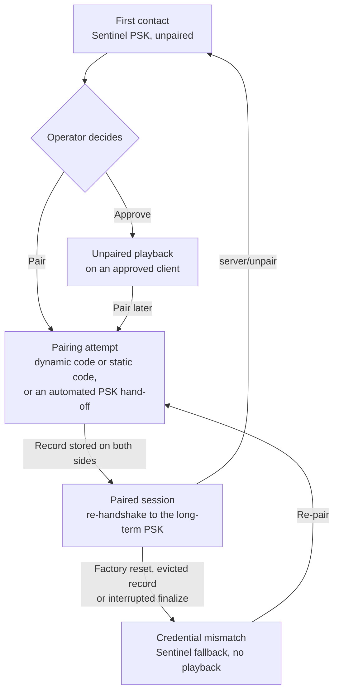

本章面向实现握手的工程师，以及必须为握手签核的人。它解释了协议保证了什么、哪些内容交由运营者处理，以及局限在哪里。这些流程本身位于[服务器 UX](/build/guide/server/ux/) 和[客户端配对](/build/guide/client/pairing/)章节中。

## 始终加密

每个 Sendspin 连接都是加密的。没有明文模式，也没有降级：无法完成握手的对端（peer）根本得不到会话。加密为你提供机密性（网络上没有人能读取音频或元数据）、完整性（被篡改的消息会未通过身份验证并终止连接）以及重放保护（重复或乱序的消息会以同样的方式失败）。每次握手中的临时密钥还带来了前向保密（forward secrecy），因此明天被盗的密钥无法解密今天录制的流量。

配对则对加密连接另一端的对端进行身份验证。

规范：[加密](/build/spec/#encryption)、[模式](/build/spec/#pattern)。

## 组成部分

**Noise `KKpsk2`。** 来自 Noise 框架的一种固定握手模式。双方在握手开始前就知道彼此的静态公钥，并且一个预共享密钥（pre-shared key）会在第二条消息的末尾被混入。无论哪一方打开了 WebSocket，服务器始终是 Noise 发起方。

**两种密码套件（cipher suite）。** ChaCha20-Poly1305 在软件实现中速度快，是微控制器上的自然选择。AES-GCM 则利用较大芯片的硬件加速。服务器两者都实现；客户端选择其中一种并予以宣告，因此不存在可能出错的协商过程。

**身份（identity）。** X25519 静态公钥就是身份。编码为文本后，它们就是 `client_id` 和 `server_id`。更换密钥就意味着变成另一台设备。

**PSK 槽位**承载三种密钥之一，而具体是哪一种则告诉双方彼此的信任程度：

- **Sentinel PSK** 是一个公开的常量。它表示尚未建立任何信任；该会话处于未配对状态。
- **配对 PSK** 是设备出厂时自带的或在首次启动时生成的密钥，由一个已经认识该设备的系统通过带外方式作为配对令牌交给服务器。它对每台服务器只用一次即可完成配对，无需任何人输入任何代码。
- **长期 PSK** 是一次成功配对的产物，作为配对记录存储在双方。它表示双方此前已经证明过自己的身份。

**前言（prologue）**将明文的起始消息混入握手过程，因此篡改它们会破坏握手。**重新握手（re-handshake）**在一个活跃连接内使用不同的 PSK 重新运行该模式，从而在不中断流的情况下将会话从未配对提升为已配对。

规范：[密码套件](/build/spec/#cipher-suites)、[身份](/build/spec/#identities)、[预共享密钥](/build/spec/#pre-shared-key)、[前言](/build/spec/#prologue)、[重新握手](/build/spec/#re-handshake)。

## 三种配对方式

**配对 PSK。** 一个已经认识该设备的系统将其配对令牌交给服务器：比如 Home Assistant 把 ESPHome 设备的密钥交给 Music Assistant，或者一个平台为自己的服务器进行预配置。该令牌同时携带 `client_id` 和配对 PSK，因此服务器知道自己在与哪台设备通信，并持有一个只有该设备才拥有的密钥。使用该 PSK 的握手从第一个字节起就对双方进行身份验证，且不需要任何人输入任何内容。谁持有令牌，谁就能配对。请把它保留在所有者自己的平台之内，像保护 Wi-Fi 密码那样保护它，并且绝不要把它打印在访客可以拍照的地方。

**动态配对码。** 设备显示或播报一个仅对本次尝试有效的六位数字码。它由握手哈希和两个随机数（nonce）派生，其中之一由设备在看到服务器的随机数之前先行提交，因此任何一方都无法操纵它。该码会输入到一个 PAKE（即 CPace）中，让双方在不发送该码的情况下证明彼此持有相同的码。如果码不对，证明会失败，且不会泄露正确的码。在两次握手之间进行中继的中间人（man in the middle）会拥有两个不同的握手哈希，因而得到两个不同的码，在两条链路上都会失败。新的长期 PSK 在网上传输时被包裹于 PAKE 输出之下，因此只有完成证明的一方才能读取它。

**静态配对码。** 同样使用 PAKE，但八位数字码是固定的并印在设备上，因此任何知道该码的人都可以配对。有两点限制了其暴露面：一次尝试需要操作者在设备上做出一个打开配对窗口的手势操作，并且该窗口在五次失败尝试后关闭。它专为没有显示屏或扬声器的设备而设；有显示屏或扬声器的设备应使用动态码。

规范：[方法](/build/spec/#methods)、[配对 PSK 流程](/build/spec/#pairing-psk-flow)、[动态配对码流程](/build/spec/#dynamic-pairing-code-flow)、[静态配对码流程](/build/spec/#static-pairing-code-flow)、[PAKE](/build/spec/#pake)、[包裹](/build/spec/#wrapping)。

## 未配对访问及其风险

Sentinel 会话是加密的，但双方都不知道对方是谁。同一网络上的人可以对服务器冒充音箱，或者对音箱冒充服务器，并在两者之间进行中继。对于客厅音箱上播放的音乐来说，这种风险每天都在以投放目标（cast target）的形式被接受，因此设备可以允许未配对访问，而服务器在运营者批准该设备后也可以使用它。

处于未配对源（source）会话中间的攻击者可以听到采集到的音频。因此，源角色需要运营者的明确批准，绝不能是按下播放键所暗示的批准，而带有麦克风或任何其他隐私敏感输入的设备在出厂时应关闭未配对访问。配对之后，服务器就能对该设备进行身份验证。

规范：[未配对访问](/build/spec/#unpaired-access)、[源消息](/build/spec/#source-messages)。

## 信任关系的生命周期

当服务器引用了一条客户端已不再持有的记录时，客户端会改用 Sentinel 密钥完成握手而不是失败，而服务器则（经客户端静态密钥验证身份后）得知自己的凭据已不可用。双方都不会仅凭该信号删除任何内容。只要那条记录还存在，服务器就不会在该设备上播放；它会把问题呈现出来并提供重新配对。如果服务器悄悄回退到未配对播放，攻击者就能通过让设备遗忘来把已配对的设备降级。

规范：[Sentinel 回退](/build/spec/#sentinel-fallback)、[配对记录](/build/spec/#pairing-records)。

## 需要保留什么，以及丢失它的代价

在**客户端**上：身份密钥对、配对 PSK、静态配对码（如果有的话）、至少五条配对记录、上次播放的服务器、未配对访问设置以及轮次计数器。丢失密钥对，设备对所有服务器来说都是陌生人。丢失记录，每台已配对的服务器都会看到不匹配并要求重新配对。丢失设备自行生成的配对 PSK，则持有其令牌的任何平台都无法再为它配对；恢复出厂设置可以恢复出厂自带的那个。如果在每次启动时都重置轮次计数器，那么一次断电重启就变成了该限制所依赖的手势操作，因此请将其持久化保存。

在**服务器**上：身份密钥对、配对记录和各项批准。丢失密钥对，你就是一个新服务器；以旧身份归档的记录毫无用处，每台设备都必须重新配对。丢失记录，你已配对的设备仍持有它们自己的记录，但你以陌生人的身份连接，由运营者重新配对。丢失批准，则由运营者重新批准。请将密钥对和记录一起备份，否则就都不要备份。

规范：[身份](/build/spec/#identities)、[配对记录](/build/spec/#pairing-records)、[定义](/build/spec/#definitions)。

## 暴力破解与冷却时间

动态码有一百万种取值，并且每次尝试都是新的；一次猜测就是一个轮次，在二十个失败的轮次之后，设备会暂缓尝试，直到操作者做出一个刻意的操作。静态码有一亿种取值，每个窗口五次尝试，且每个窗口都需要一次手势操作。

请在失败的轮次之间加入冷却时间，因为这些限制依赖于操作者刻意的手势操作。如果计数器在重启时被重置，那么控制着音箱智能插座的攻击者就可以反复重置它并继续猜测。以此方式获得的配对记录，即使后来固件更新添加了隐私敏感的角色，也与合法记录无法区分。请添加一个从几秒起步、每失败一个轮次就翻倍的冷却时间，以拖慢反复猜测。

规范：[轮次](/build/spec/#rounds)、[配对窗口](/build/spec/#pairing-window)。

## 供合规归档使用

轮次限制、窗口和尝试次数限制，以及冷却时间，正是测试实验室在询问身份验证如何抵抗暴力破解时可以指向的内容；ETSI EN 303 645 条款 5.1-5 和 EN 18031-1 机制 AUM-6 正是提出这个问题。请记录你的固件所强制执行的各项限制，以及重置这些限制的手势操作。每设备唯一的身份密钥、配对 PSK 以及取自 CSPRNG 的静态码，可以满足关于通用默认凭据的条款要求。

设备还可以更进一步：在存在每设备凭据之前保持 Sendspin 处于禁用状态，这样它绝不会在没有身份的情况下在网络上进行应答。ESPHome 为此提供了一个动作，让你无需更改协议即可构建 EN 18031 风格的默认设置。开启访客模式时，来自未经身份验证的对端的音频会到达你的解码器。请把解码路径视为面向网络的输入，并对其进行模糊测试（fuzzing）。

## 接下来去哪里查阅

已记录的配对和入门流程位于[用户对服务器的期望](/build/guide/server/ux/)中。设备侧的选择，即提供哪些方式以及如何展示配对码，位于[客户端配对](/build/guide/client/pairing/)中。上述所有内容的规范性文本从规范中的[配对](/build/spec/#pairing)开始。
