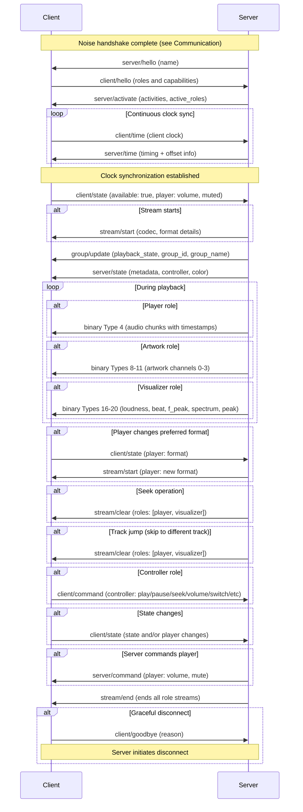
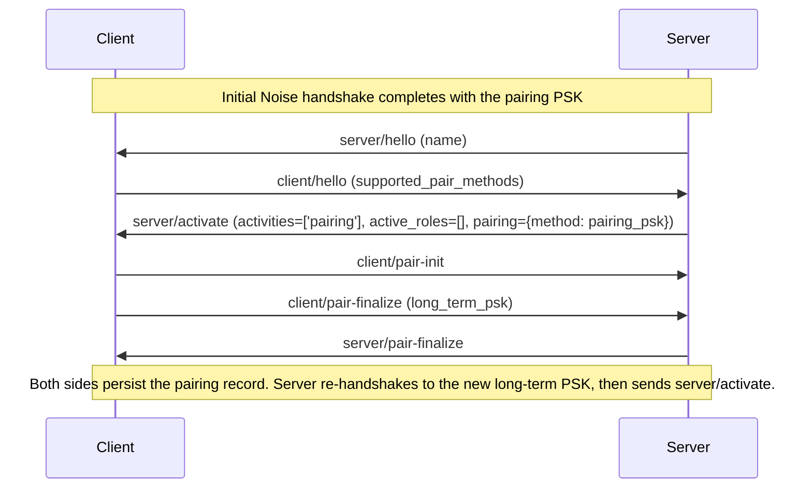
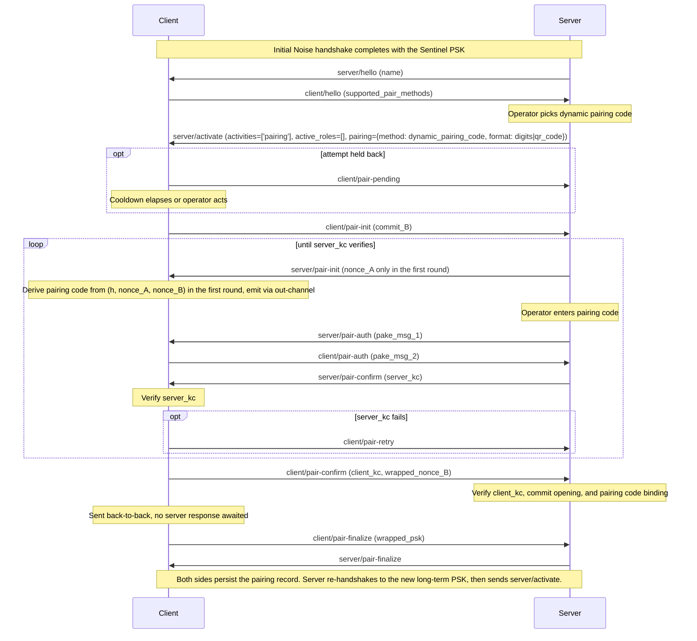
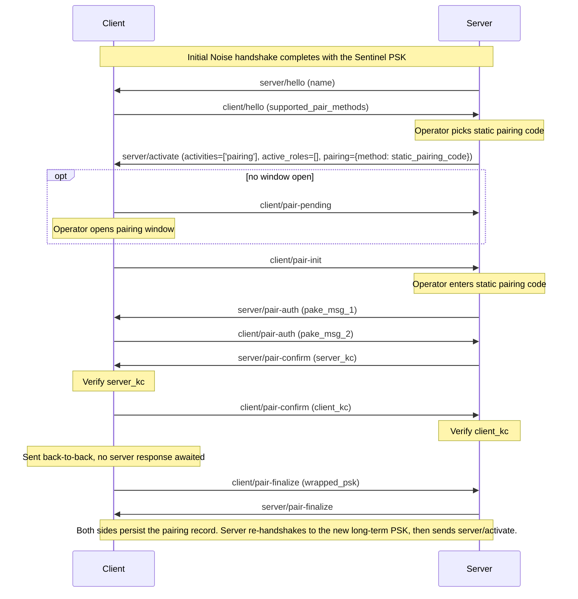

<!-- Synced from https://github.com/Sendspin/spec/commit/671a34d408581fc25ea56b3528a4a3f13e3be901 -->

Sendspin 是一种多房间音乐体验协议。该协议的目标是协调构成音乐聆听体验的所有设备（device）。这包括同时在多个扬声器上输出音频、通过屏幕和灯光可视化音频或专辑封面，以及由壁挂平板电脑提供媒体控制。
## 许可与商标

Sendspin 是一个开放、免版税（royalty-free）的协议，任何人都可以实现。本规范基于 [Community Specification License 1.0](https://github.com/Sendspin/spec/blob/main/LICENSE.md) 授权，其中包括每位贡献者就其[范围（Scope）](https://github.com/Sendspin/spec/blob/main/SCOPE.md)内的规范实现所授予的免版税专利许可。贡献将根据[贡献者许可协议（Contributor License Agreement）](https://github.com/Sendspin/spec/blob/main/CONTRIBUTOR-LICENSE-AGREEMENT.md)被接受。

Sendspin 是 Open Home Foundation 的商标。实现该协议并不授予在商业产品上使用 Sendspin 名称或标志的权利；参见 [TRADEMARKS.md](https://github.com/Sendspin/spec/blob/main/TRADEMARKS.md)。

本材料按“现状”提供。贡献者和被许可人明确声明不提供与本材料相关的任何保证（明示的、默示的或其他形式的保证），包括对适销性、不侵权、特定用途适用性或权利所有权的默示保证。实现或以其他方式使用本材料的全部风险由实现者和用户自行承担。在任何情况下，贡献者或被许可人均不对任何其他方承担因本交付物或其管辖协议所引起的任何诉由而导致的利润损失或任何形式的间接、特殊、附带或后果性损害的责任，无论该责任基于违约、侵权（包括过失）还是其他原因，也无论对方成员是否已被告知发生此类损害的可能性。
## 规范性语言

本文档中的关键词 "MUST"、"MUST NOT"、"REQUIRED"、"SHALL"、"SHALL NOT"、"SHOULD"、"SHOULD NOT"、"RECOMMENDED"、"NOT RECOMMENDED"、"MAY" 和 "OPTIONAL"，当且仅当它们像此处所示以全大写形式出现时，应按照 BCP 14 [RFC 2119](https://www.rfc-editor.org/rfc/rfc2119) [RFC 8174](https://www.rfc-editor.org/rfc/rfc8174) 中所描述的方式进行解释。
## 协议概述

一次典型的会话，从握手、播放到断开连接：


## 定义

- **服务器（Server）** - 协调所有设备、生成音频流、管理播放器和客户端、提供元数据
- **客户端（Client）** - 能够播放音频、采集音频输入、可视化音频、显示元数据、显示颜色或提供音乐控制的设备或应用程序。可担任不同的角色（播放器、音源、元数据、控制器、封面、可视化器、颜色）。每个客户端都有唯一的标识符
  - **播放器（Player）** - 接收音频并同步播放。拥有自己的音量和静音状态以及首选格式设置
  - **音源（Source）** - 从本地输入采集音频，并将其流式传输到服务器
  - **控制器（Controller）** - 控制该客户端所属的分组
  - **元数据（Metadata）** - 显示文本元数据（标题、艺术家、专辑等）
  - **封面（Artwork）** - 显示封面图片。拥有首选的图片格式
  - **可视化器（Visualizer）** - 将音乐可视化。拥有音频特征的首选格式
  - **颜色（Color）** - 接收从当前音频中提取的颜色
- **分组（Group）** - 一组客户端。每个客户端恰好属于一个分组，且每个分组至少包含一个客户端。每个分组都有唯一的标识符。每个分组具有以下状态：成员客户端列表、音量、静音和播放状态
- **流（Stream）** - 关于二进制数据在任一方向上如何格式化和发送的客户端特定细节。每个角色的流单独管理。对于服务器到客户端的流，每个客户端根据自己的能力和偏好接收独立编码的流。对于播放器，服务器会在客户端缓冲区容量允许的范围内尽可能提前发送音频数据块。对于封面客户端，服务器通过该流发送专辑封面和其他可视化图像
- **CSPRNG** - 以足够的熵（entropy）作为种子的密码学安全伪随机数生成器（[RFC 4086](https://www.rfc-editor.org/rfc/rfc4086)）；硬件 RNG 也符合要求
- **身份（Identity）** - 用于在 [Noise](#encryption) 握手中标识客户端或服务器的 Curve25519 密钥对。Base64URL 编码的公钥（43 个字符，无填充）用作 `client_id` 或 `server_id`。在重启后保持不变。私钥必须取自 CSPRNG。
- **长期 PSK（long-term PSK）** - 在[配对](#pairing)期间建立的 32 字节预共享对称密钥，并在之后的每次连接中混入 [Noise](#encryption) 握手状态。必须取自 CSPRNG。
- **配对 PSK（pairing PSK）** - 在[配对 PSK 方法](#pairing)中用作 PSK 的 32 字节对称密钥。它始终与客户端的静态公钥（`client_id`）一同分发，服务器需要该公钥来验证客户端身份。操作者将其作为[配对令牌](#pairing-token)输入服务器，可以文本形式复制或以二维码形式扫描。它不同于配对所产生的长期 PSK。必须取自 CSPRNG。
- **配对码（Pairing Code）** - 在基于码的[配对](#pairing)方法中使用的值。静态配对码方法使用固定的 8 位十进制值；动态配对码方法使用每次会话生成的值，以 6 位十进制码或二维码的形式发出（参见[动态配对码流程](#dynamic-pairing-code-flow)）。
- **出厂重置（Factory Reset）** - 将设备恢复到出厂状态：制造商预置的凭据和设置（身份密钥对、配对 PSK、静态配对码、已校准的[输出延迟](#client--server-clientstate-player-object)）被恢复；此后积累的一切内容（包括配对记录）都被清除。
- **已配对会话（Paired Session）** - 以长期 PSK 为密钥的会话，即客户端持有针对该服务器的配对记录。以配对 PSK 或 Sentinel PSK 为密钥的会话是*未配对*的，这将把服务器限制为只能进行配对交换，或在启用[未配对访问](#unpaired-access)时进行正常的播放和控制流程。双方都不会在网络上传输此信息：双方都是从 [Noise](#encryption) 握手期间匹配到的 PSK 中派生出该状态。
## 角色版本控制

角色定义了客户端具备哪些能力与职责。所有角色都使用带 `@` 字符的显式版本控制：`<role>@<version>`（例如 `player@v1`、`controller@v1`）。

本规范定义了以下角色：[`player`](#player-messages)、[`source`](#source-messages)、[`controller`](#controller-messages)、[`metadata`](#metadata-messages)、[`artwork`](#artwork-messages)、[`visualizer`](#visualizer-messages)、[`color`](#color-messages)。所有服务器必须（MUST）实现本规范中描述的这些角色的所有版本。

所有不以 `_` 开头的角色名称和版本均保留，供本规范的未来修订版使用。

### 优先级与激活

客户端在 `supported_roles` 中按优先级顺序列出角色（最优先的排在最前）。如果客户端支持某个角色的多个版本，则应当（SHOULD）全部列出：`["player@v2", "player@v1"]`。

服务器对每个角色族（role family）最多激活一个版本（例如一个 `player@vN`、一个 `controller@vN`）——即从客户端列表中选择服务器所实现的第一个匹配项；如果服务器策略拒绝激活该角色族，则不激活任何版本。服务器不得（MUST NOT）激活客户端未在 `supported_roles` 中列出的角色或版本。服务器在 `active_roles` 中报告已激活的角色；客户端必须参考其已接收的 `server/activate` 消息所建立的激活状态，并避免为未激活的角色发送命令或状态。

消息对象键（例如 `player?`、`controller?`）使用不带版本号的角色名称。服务器根据客户端的 `active_roles` 确定应使用的版本。

### 检测过期的服务器

服务器应当跟踪客户端请求其未实现的角色或角色版本的情况（以 `_` 开头的角色除外）。这表明客户端所支持的角色版本比服务器更新，服务器需要更新。

该机制只能检测角色版本偏差（role-version skew），而且这仅是因为角色是在握手（handshake）之后才交换的。更新版的核心 `version`、密码套件（cipher suite）或握手（密码或握手的变更本身就是核心 `version` 的升级）会使[握手](#failure-handling)在角色交换之前中止，因此这种偏差会表现为连接失败，而不是通过这种角色请求信号暴露出来。

### 应用特定的角色

规范之外的自定义角色以 `_` 开头，并且在通告（advertise）时必须包含明确的版本号（例如 `_myapp_controller@v1`、`_custom_display@v1`）。为避免独立厂商之间发生冲突，自定义角色名称应当包含厂商专属前缀（例如 `_vendorname_role`）。

它们的二进制消息 ID 来自不受管理的 192-255 范围：应用特定角色自身的定义负责分配其 ID，客户端不得通告两个 ID 冲突的角色。
## 协议演进

本节描述本规范的未来修订版本如何添加标准协议功能、角色（role）和角色版本。它不会授予[应用特定角色](#application-specific-roles)额外的权限。

核心（core）和角色版本定义行为以及消息格式。如果未选择某个新功能，现有行为必须保持不变。破坏现有角色契约的变更需要新的角色版本。破坏现有行为的核心变更需要新的核心版本，除非该变更仅在双方对等端（peer）都明确选择加入时才能应用。

本规范的未来修订版本可以添加可选信息，前提是较旧的接收方能够在不改变消息含义的情况下忽略它。如果某个新功能需要接收方以不同的方式行动，发送方在依赖该行为之前必须通过角色激活或明确定义的能力协商确认支持。匹配的核心版本、对等端的软件版本以及未出现错误都不能确认支持。新功能应当使用角色支持对象来表示角色特定的能力。

改变整个连接范围行为的功能（例如准入或所有权）必须定义双方对等端如何选择加入，以及未选择加入时会发生什么。它不得破坏适用于其他连接上未选择加入的对等端的协议规则。对某个角色的支持不得被视为对单独的整个连接范围功能的支持，除非该角色版本明确包含这种支持。
## 建立连接

Sendspin 有两种标准的连接建立方式：服务器发起和客户端发起。建议（RECOMMENDED）使用服务器发起的连接，因为它们能提供标准化的多服务器行为。

服务器必须（MUST）支持下述两种方法。客户端同一时间必须恰好使用这两种方法中的一种，并相应地进行广播或发现。

WebSocket 传输必须是纯 `ws://`。机密性与完整性由 WebSocket 载荷内部的 [Noise 层](#encryption) 端到端地提供。

### 服务器发起的连接

客户端通过 mDNS 宣告自身的存在，具体如下：
- 服务类型：`_sendspin._tcp.local.`
- 端口：Sendspin 客户端正在监听的端口（推荐：`8928`）
- TXT 记录：`path` 键指定 WebSocket 端点，必需（REQUIRED）（推荐值：`/sendspin`）
- TXT 记录：`name` 键指定客户端的友好名称（可选（OPTIONAL））

服务器通过 mDNS 发现可用的客户端，并使用所广播的地址和路径通过 WebSocket 连接到每个客户端。

TXT `name` 应当（SHOULD）与客户端在 [`client/hello`](#client--server-clienthello) 中发送的 `name` 一致。它只是发现阶段的提示；如果两者不同，则以 `client/hello` 中的值为准。

客户端在广播 `_sendspin._tcp` 期间不得（MUST NOT）手动连接到服务器。

#### 多个服务器（服务器发起）

除非下文另有说明，客户端同一时间最多持有一条已获接纳的（admitted）连接，并按其声明的 [`activities`](#server--client-serveractivate) 中排名最高的活动进行分类；从高到低依次为：

- `'playback'`
- `'pairing'`

`activities` 为空的连接排名最低。

客户端必须持久化存储最近一次在其 `activities` 包含 `'playback'` 期间持有已获接纳连接的那台服务器的 `server_id`（即“最后播放的服务器”）。

当有新的服务器连入时，客户端会先让握手完成，再执行接纳判定；在其第一条 [`server/activate`](#server--client-serveractivate) 声明自身优先级之前，这条新连接都属于临时连接（provisional）。客户端不得将优先级规则应用于不符合[可接纳条件](#server--client-serveractivate)的激活（activation）。传入连接的优先级会与当前连接的优先级进行比较：更高或相等则被接受，更低则被拒绝。存在以下三种例外：

- [配对尝试](#entering-and-leaving-pairing)不会被传入的 `'playback'` 或 `'pairing'` 连接所取代。
- 当当前持有者与传入连接的 `activities` 都为空时，仅当传入连接的 `server_id` 与最后播放的服务器匹配（而现有连接的不匹配）时，才接纳传入连接；否则保留现有连接。
- 客户端可以（MAY）在已接纳的 `'playback'` 连接之外，再接纳一条传入的 `'pairing'` 连接，同时持有两者。不同时接纳两条连接的客户端会以 [`pair/abort`](#client--server-pairabort) 原因 `concurrent_attempt` 拒绝传入连接，并关闭该连接。在同时持有两者期间，后续传入的连接将与持有 `'playback'` 的连接进行仲裁。当稍后的 `server/activate` 将 `'pairing'` 从该连接的 `activities` 中移除时，客户端会将该连接与持有 `'playback'` 的连接进行仲裁，如同它是新传入的一样。

除上述情形外，后续的 `server/activate` 更新不会触发仲裁，即使某条连接提升了其活动（activities）。临时连接如果在 30 秒内未发送 `server/activate`，就会被丢弃。客户端可以限制同时持有的临时连接数量，将后续传入的连接视作较低优先级而予以拒绝。

被取代的连接会收到 [`client/goodbye`](#client--server-clientgoodbye) 原因 `'another_server'`（若该连接是配对握手，则收到 [`pair/abort`](#client--server-pairabort) 原因 `concurrent_attempt`）。被拒绝的传入连接会收到 [`client/goodbye`](#client--server-clientgoodbye) 原因 `'concurrent_attempt'`（对于配对，则为 [`pair/abort`](#client--server-pairabort) 原因 `concurrent_attempt`）。随后客户端会关闭该连接。

### 客户端发起的连接

如果客户端更倾向于由自己主动发起连接，而不是等待服务器来连接，则服务器必须可通过 mDNS 被发现，具体如下：
- 服务类型：`_sendspin-server._tcp.local.`
- 端口：Sendspin 服务器正在监听的端口（推荐：`8927`）
- TXT 记录：`path` 键指定 WebSocket 端点，必需（推荐值：`/sendspin`）
- TXT 记录：`name` 键指定服务器的友好名称（可选）

客户端通过 mDNS 发现服务器，并使用所广播的地址和路径发起 WebSocket 连接。

TXT `name` 应当与服务器在 [`server/hello`](#server--client-serverhello) 中发送的 `name` 一致。它只是发现阶段的提示；如果两者不同，则以 `server/hello` 中的值为准。

客户端在使用客户端发起的连接时不得广播 `_sendspin._tcp`。

#### 多个服务器（客户端发起）

与服务器发起的连接不同，服务器无法通过重新连接来重新夺回客户端。客户端如何处理多个已发现的服务器、如何进行服务器选择和切换，均由实现自行定义（implementation-defined）。

**注意：** 从这里开始，Sendspin 的运行不再依赖于连接是如何建立的。
## 加密

所有 Sendspin 连接均使用基于 [Noise 协议框架（Noise Protocol Framework）](https://noiseprotocol.org/noise.html) 的端到端加密。

### 模式

Sendspin 使用 `KKpsk2` Noise 模式。双方的静态密钥彼此预先已知（客户端的 `client_id` 和服务器的 `server_id` 即为静态公钥），并在握手第二条消息的末尾混入一个[预共享密钥（Pre-Shared Key）](#pre-shared-key)。

**服务器是 Noise 发起方（initiator）**，**客户端是 Noise 响应方（responder）**，无论由哪一方发起 WebSocket 连接。

**安全特性。** 前向保密（forward secrecy）由每次握手中的临时密钥 DH 提供：静态密钥或 PSK 的泄露不会追溯解密先前会话的传输流量（例外是第一条握手消息的负载，可用客户端的静态密钥恢复）。重放保护由 Noise 的按方向传输计数器提供；重复或乱序的密文将导致 AEAD 解密失败并中止连接。

### 密码套件

套件指定完整 Noise 协议名称中的 `<DH>_<cipher>_<hash>` 部分。Sendspin 定义了两个：

- `25519_ChaChaPoly_SHA256` - 适合软件实现的套件
- `25519_AESGCM_SHA256` - 硬件加速套件（AES-NI / ARMv8 Crypto Extensions）

服务器必须支持这两种套件。客户端必须至少支持一种。

客户端选择一个套件并在 [`client/init`](#client--server-clientinit) 中声明；由于要求服务器支持每一种套件，因此无需协商。

### 身份

`client_id` 和 `server_id` 字段分别是客户端和服务器经过 base64url 编码（无填充）的 Curve25519 公钥，每个为 43 个字符。这些密钥既作为路由/持久化标识符，也作为 Noise 握手中使用的静态密钥。私钥必须在每台设备上取自 [CSPRNG](#definitions)，并且不得是跨设备共享的固定默认值。

**密钥轮换。** 每一方的静态密钥对都是长期使用的；标识符即公钥，因此轮换密钥对会改变身份。轮换了静态密钥对的服务器（例如，硬件重新配置、主机迁移、私钥丢失）在客户端看来是另一台服务器。希望在服务器迁移期间保持身份的操作者必须保留服务器的静态私钥（例如，作为服务器备份/恢复集的一部分）。

### 预共享密钥

PSK 在第二条握手消息的末尾混入握手状态（`psk2` 修饰符）。因此，握手之后派生的传输模式密钥包含 PSK，但第一条握手消息的负载（由服务器发送）在加密时并未混入 PSK。

为了让客户端在必须混入 PSK 之前选出正确的 PSK，服务器会在第一条握手消息的负载中包含 `psk_id` 和 `psk_category`。该标识符是一个 43 字符的 base64url 编码值（无填充），来自 32 字节的 SHA-256 输出，并由 PSK 确定性地派生：

```
psk_id = base64url(SHA-256("sendspin-psk-id-v1" || PSK))
```

标签为所示字面字符组成的 UTF-8 字节序列（无 NUL 终止符，无外层引号）；`||` 表示字节串联。同一公式适用于所有三种 PSK 类别（长期、配对、Sentinel）；客户端存储其每个 PSK 时都会标记其所属类别。`psk_category` 声明服务器将所引用的 PSK 用作哪个类别——`'lt'`（长期）、`'pr'`（配对）或 `'sn'`（Sentinel）——因此匹配会使双方绑定到同一类别，而该类别决定了后续的处理方式。三种情况均使用同一个握手模式（`KKpsk2`）；仅 PSK 输入不同。

**Sentinel PSK** 是一个公开的常量，在没有其他 PSK 适用时用作 PSK 输入。它本身不提供任何身份验证（其值是公开的）；所需的身份验证会在稍后的[配对（Pairing）](#pairing)过程中建立。该 Sentinel 值为：

```
Sentinel PSK = SHA-256("sendspin-sentinel-psk-v1")
             = 0x1b5e24dbc1aed95fc2a5a338a90c05df44bd10f5ec1f4cd66cbf86272767b9d3
```

因此，其 `psk_id` 同样是一个公开的常量：

```
Sentinel psk_id = 0x185b15f6d2da4909bd1dc156a4ab206103abef0153bcd52d926170b95cf7ce8a
                = base64url "GFsV9tLaSQm9HcFWpKsgYQOr7wFTvNUtkmFwuVz3zoo"
```

客户端解密第一条握手消息的负载（如上所述，无需 PSK 即可完成），将其中包含的 `psk_id` 与所声明 `psk_category` 的每个候选 PSK 的哈希值进行比较，并选出匹配的那个。随后，客户端混入该 PSK 以处理第二条握手消息。如果没有候选 PSK 匹配，客户端回退到 Sentinel PSK（参见 [Sentinel 回退](#sentinel-fallback)）。

每个[长期 PSK](#definitions) 都会与服务器端的 `server_id` 一起持久化保存在[配对记录](#pairing-records)中。在 `psk_id` 匹配之后，客户端会验证匹配 PSK 所存储的 `server_id` 是否与 [`server/init`](#server--client-serverinit) 中的一致；不一致则握手失败。

### Sentinel 回退

`psk_id` 查找未命中（lookup miss）意味着服务器引用了一个客户端无法使用的凭据：客户端丢失了其配对记录（例如，发生了[恢复出厂设置（Factory Reset）](#definitions)、记录[被逐出（eviction）](#pairing-records)或存储故障）、[配对完成（pairing finalize）](#server--client-serverpair-finalize)被中断导致客户端没有服务器已持久化的记录，或者客户端持有所引用 PSK 的类别与所声明的 `psk_category` 不同。在初始握手中发生查找未命中时，客户端会使用 Sentinel PSK 完成第二条握手消息，而不是直接失败。该回退仅适用于此场景：在[重新握手](#re-handshake)期间发生的未命中，以及匹配后对存储公钥的检查失败（属于错误绑定，而非未命中），仍会照常导致握手失败。

服务器会使用其第一条消息所引用的 PSK 来验证第二条握手消息。如果验证失败且所引用的 PSK 不是 Sentinel，则服务器会在将握手视为失败之前，使用 Sentinel PSK 再次验证该消息。在 Sentinel 下通过验证的第二条消息是一个经过身份验证的**凭据不匹配信号**：握手会对客户端的静态密钥进行身份验证，因此该信号证明其持有者无法使用所引用的 PSK。仅有该信号本身，不得导致任何一方移除或替换记录。

会话会作为一个普通的[未配对](#definitions)、以 Sentinel 为密钥的会话继续进行，但在其配对记录存在期间，服务器不得激活角色或声明 `'playback'` 活动——会话要么承载[配对](#pairing)交换，要么保持空闲。服务器应当向其操作者呈现这一不匹配情况并提供重新配对；重新配对会替换记录并恢复正常服务。

### 序言（Prologue）

双方混入 Noise 握手状态的序言，是 [`client/init`](#client--server-clientinit) 的确切字节后接 [`server/init`](#server--client-serverinit) 的确切字节的串联，与线路上传输的内容完全一致（即 JSON 编码的 UTF-8 消息体，不含 WebSocket 帧封装）。这会将明文的 init 交换与握手绑定在一起；任何篡改都会导致握手失败。

双方必须对完全按发送和接收原样的原始消息字节进行哈希，而不是对解析后消息的重新编码。

### 失败处理

仅凭明文 [`client/init`](#client--server-clientinit) 即可判定的服务器端失败——不受支持的 `version`、未知的 `suite`，或并非所定义结构的有效 JSON 的消息——属于 **init 失败**：服务器必须发送带有对应原因的 [`server/error`](#server--client-servererror)，然后关闭连接。该消息未经身份验证，因此该原因仅作为日志记录和操作者界面展示的提示。

能够作为消息信封 JSON 解析、且其 `version` 为 `1` 以外整数的 `client/init`，无论其其他负载字段如何，均为 `unsupported_version`，因为未来的版本可能定义不同的结构。所有其他结构失败（包括并非有效 JSON 的输入）均为 `malformed`；`suite` 在 `version` 之后检查，随后是其余字段。

所有其他握手阶段失败——客户端拒绝 `server/init`、握手超时、内部 `noise/handshake` 负载格式错误、未经 [Sentinel 回退](#sentinel-fallback) 处理的 `psk_id` 查找未命中、Noise AEAD 失败、进入传输模式后的 AEAD 失败，或切换到传输模式后收到的明文消息——均属于**静默失败**：检测到失败的一方直接关闭连接，不再发送任何消息。

实现应当设置超时（例如，30 秒），限定在序言和 Noise 握手阶段中每一方接收下一条预期消息的时间。

### 重新握手

服务器可以在传输模式下重新运行 Noise 握手，以便在不关闭 WebSocket 的情况下更换会话密钥——通常用于在成功[配对](#pairing)后将 会话提升为已配对状态、从 Sentinel 切换到配对 PSK，或在长时间运行的连接上轮换会话密钥。

由服务器发起，与初始握手相同。两条 [`noise/handshake`](#client--server-noisehandshake) 消息作为加密的二进制消息在当前通道内发送；noise 消息 1 中的 `psk_id` 和 `psk_category` 为新会话选择 PSK。`client/init` 和 `server/init` 不会重新发送——`client_id`、`server_id` 和 `suite` 延续使用。新握手的序言是先前握手的哈希 `h`。一旦新密钥就位，服务器必须发送 [`server/activate`](#server--client-serveractivate) 作为其在新密钥下的第一条消息。[`server/hello`](#server--client-serverhello) 和 [`client/hello`](#client--server-clienthello) 均不会重新发送。该激活是同一连接上的后续激活。激活规则（包括针对省略 `active_roles` 的规则）在新匹配的 PSK 下适用。

服务器在发送 Noise 消息 1 之后不得开始新的应用消息，客户端在收到该消息之后亦然，握手消息和 `server/activate` 除外。当服务器发送或客户端收到新的 `server/activate` 时，此限制即告结束。

服务器必须容忍在 Noise 消息 2 之前收到的使用旧密钥的有效应用消息，因为客户端可能在收到消息 1 之前就已发送这些消息。服务器可以在不处理、不响应的情况下丢弃这些消息。

连接状态（例如带有其缓冲数据的已打开流，或[时间过滤器](#clock-synchronization)）会在重新握手过程中保持；只有会话密钥以及握手本身派生的内容会发生变化。
## 通信

WebSocket 连接建立后，客户端（Client）与服务器（Server）在交换应用数据之前会先执行一次初始握手：

1. 客户端 → 服务器：[`client/init`](#client--server-clientinit)（明文）
2. 服务器 → 客户端：[`server/init`](#server--client-serverinit)（明文）
3. 服务器 → 客户端：[`noise/handshake`](#client--server-noisehandshake) - Noise 消息 1（明文）
4. 客户端 → 服务器：[`noise/handshake`](#client--server-noisehandshake) - Noise 消息 2（明文）
5. 双方切换到 Noise 传输模式。从此时起，所有 Sendspin 应用数据都将以 WebSocket 二进制消息的形式发送，其负载为 Noise 传输消息。
6. 服务器 → 客户端：[`server/hello`](#server--client-serverhello)（加密）
7. 客户端 → 服务器：[`client/hello`](#client--server-clienthello)（加密）
8. 服务器 → 客户端：[`server/activate`](#server--client-serveractivate)（加密）

在发送初始的 [`server/activate`](#server--client-serveractivate) 之前，服务器不得（MUST NOT）发送其他 Sendspin 消息，但在初始化失败时用来代替 `server/init` 发送的 [`server/error`](#server--client-servererror) 除外。在收到该激活消息之前，客户端不得发送其他 Sendspin 消息，但在初始 Noise 握手完成后，客户端可以（MAY）发送一条加密的 [`client/goodbye`](#client--server-clientgoodbye)。[故障处理](#failure-handling)中定义的静默失败仍会在不发送任何后续消息的情况下关闭连接。加密细节请参见[加密](#encryption)。

明文握手消息（`client/init`、`server/init`、`noise/handshake`、`server/error`）各自作为一条完整的 WebSocket **文本**（text）消息发送，其中包含 JSON。加密通道建立后，所有消息均以承载 Noise 传输消息的 WebSocket **二进制**（binary）消息形式发送。

WebSocket 消息可能跨越多个 RFC 6455 帧。Sendspin 仅在完整的 WebSocket 消息上操作。这种 WebSocket 分片与 Sendspin 的[分片](#fragmentation)是不同的。

WebSocket 控制帧（Ping、Pong、Close；RFC 6455）不是 Sendspin 消息：它们在任何时候都保持有效，不会在 Noise 层被加密，并且 Ping/Pong 是预期的连接存活检测机制。

在字段定义中，`?` 表示可选字段（例如，`field?`: type 表示该字段可以省略）。

所有 JSON 消息都有一个标识消息的 `type` 字段和一个包含消息特定数据的 `payload` 对象。负载结构因消息类型而异，并在下文各消息章节中详细说明。

**消息类型前缀。** 消息 `type` 中 `/` 之前的前缀标识一组消息。`client/` 和 `server/` 指明发送方。`stream/` 涵盖控制从服务器到客户端的二进制信道的消息，`client-stream/` 则涵盖控制从客户端到服务器的二进制信道的消息；这两种信道相互独立，各自拥有独立的生命周期。`group/`、`pair/` 和 `noise/` 表示主题。只有 `client/`、`server/` 和 `client-stream/` 隐含方向；其他每个前缀所对应的方向由各消息的定义给出。

**向前兼容。** 客户端和服务器必须（MUST）忽略无法识别的 `payload` 字段（即未为该消息定义的键），而不是将其视为错误。客户端和服务器不得发送规范未为该消息定义的字段，但消息明确允许的以 `_` 为前缀的[应用特定角色](#application-specific-roles)对象，以及 `client/hello` 中针对已通告的应用特定角色版本的支持对象（例如 `player@_experimental_support`）除外。

客户端和服务器必须忽略带有无法识别的 `type` 的 JSON 消息，前提是该消息是包含 `type` 字符串和 `payload` 对象的有效 JSON 对象。它们还必须忽略其未实现相应 ID 的二进制消息。在服务器发送初始的 [`server/activate`](#server--client-serveractivate)，或客户端接收到该消息之后，这些规则即适用。

在[重新握手](#re-handshake)期间，这些忽略规则仅适用于重新握手规则所允许的消息，包括使用先前会话密钥加密、且在 Noise 消息 2 之前被服务器接收的有效消息。

在发送本规范未来修订版所新增功能的消息或字段之前，发送方必须通过角色激活或显式能力协商确认支持。该功能所规定的协商字段不受此要求约束。本规范为现有消息新增的可选信息性字段同样不受此要求约束，前提是较旧的接收方能够在不改变消息含义的情况下忽略它们。未收到错误并不能证明接收方理解或处理了该消息。本规范的未来修订版可以在现有消息中定义较旧接收方可忽略的协商字段。参见[协议演进](#protocol-evolution)。

Noise 认证以及针对已识别消息的校验、方向和顺序规则仍然适用。接收方已实现的 ID，即使其所属角色处于非活动状态，仍会被视为已识别。已知字段中出现无法识别的值时，应遵循该字段自身的规则，而不是忽略无法识别字段的规则。

消息格式示例：

```json
{
  "type": "stream/start",
  "payload": {
    "server_transmitted": 1234567890,
    "player": {
      "codec": "opus",
      "sample_rate": 48000,
      "channels": 2,
      "bit_depth": 16
    },
    "artwork": {
      "channels": [
        {
          "source": "album",
          "format": "jpeg",
          "width": 800,
          "height": 800
        }
      ]
    }
  }
}
```

WebSocket 二进制消息用于发送 JSON 负载、音频数据块、媒体封面和可视化数据。每条完整的二进制消息恰好承载一条 Noise 传输消息；经 AEAD 解密后，第一个字节是表示消息类型的 uint8。在本规范中，位 0 指最低有效位。

丢弃二进制角色负载的接收方仍必须处理 Noise 消息、遵循下文的分片规则，并执行该角色所要求的消息检查。

### 二进制消息 ID 结构

每条解密后二进制消息的第一个字节就是其消息 ID。ID 按下表进行分配；每个角色的二进制消息定义都会指明其所使用的确切 ID。

| ID | 分配 |
|---|---|
| 0 | JSON 消息主体（UTF-8） |
| 1 | [分片](#fragmentation) |
| 2-3 | 保留供将来使用 |
| 4-7 | 播放器角色 |
| 8-11 | 封面（Artwork）角色 |
| 12-15 | 音源（Source）角色 |
| 16-23 | 可视化（Visualizer）角色 |
| 24-191 | 保留供未来角色使用 |
| 192-255 | 可供[应用特定角色](#application-specific-roles)使用 |

未来的角色将从保留的 24-191 范围内按对齐方式分配包含 4 个或 8 个 ID 的区块。

**注意：** 各角色版本共享相同的二进制消息 ID（例如，`player@v1` 和 `player@v2` 都使用 ID 4-7）。

### 分片

根据 Noise 规范，单条 Noise 传输消息的大小限制为 65535 字节。两种已定义的密码套件均使用 16 字节的 AEAD 认证标签，且消息类型字节占用 AEAD 明文的第一个字节，因此每条 Noise 传输消息的应用负载最多为 65535 − 16 − 1 = 65518 字节。更大的消息必须使用分片消息类型拆分到多条 WebSocket 二进制消息中发送。

**线上格式**（每条分片消息中受 AEAD 保护的明文内部）：

- 首个分片：`[1][flags][orig_type][data]`
- 后续分片：`[1][flags][data]`

`flags` 是一个 uint8。消息的首个分片会设置位 1，最后一个分片则设置位 0。位 2-7 为保留位，必须为零。

将所有分片的 `data` 拼接起来即可得到原始消息的负载（也就是在类型为 `orig_type` 的非分片消息中，紧随消息类型字节之后的那些字节）。

**约束条件：**

- 每个方向同一时间只能有一个分片消息处于在途状态。发送方必须以最后一个分片结束某个分片消息之后，才能在该方向上发送任何其他二进制消息，无论其是否分片。
- 发送方不应（SHOULD NOT）对能够容纳于单条 Noise 传输消息中的消息进行分片。
- 发送方不得使用 `1` 作为 `orig_type`。

**接收方行为：** 维护单个重组缓冲区以及对应的在途 `orig_type`。收到首个分片时，从字节 2 读取 `orig_type`，并以其 `data` 开始一个新的缓冲区；收到任何其他分片时，将其 `data` 追加到缓冲区中。当位 0 被设置时，将缓冲区作为一条类型为 `orig_type` 的完整消息进行分发，然后清空缓冲区。

[忽略规则](#communication)同样适用于分片消息。如果接收方未实现 `orig_type`，它可以丢弃每个分片的 `data`，而不必分配重组缓冲区。但它仍必须对每条 Noise 传输消息进行认证、跟踪分片序列，并执行下文的畸形序列规则。最后一个分片会清除序列状态。被丢弃的消息不会被分发。

**畸形序列**属于协议错误；接收方必须关闭连接。畸形序列包括：在某个分片消息在途期间收到首个分片、在没有任何分片消息在途时收到非首个分片、在某个分片消息在途期间收到非分片的二进制消息、保留标志位非零，以及 `orig_type` 为 `1`。
## 时钟同步

客户端发送 `client/time` 消息，以在其时钟与服务器时钟之间保持准确的映射。实现必须足够频繁地发送这些消息，以使滤波器保持收敛。time-filter 库的[推荐用法](https://github.com/Sendspin-Protocol/time-filter#recommended-usage)一节描述了一种已知良好的突发策略基线。

二进制音频消息包含服务器时域中的时间戳，用于指示音频应当播放的时刻。客户端必须使用 [time-filter](https://github.com/Sendspin-Protocol/time-filter) 算法将服务器时间戳转换为其本地时钟，以实现同步播放。该时间滤波器是一个二维卡尔曼滤波器，同时跟踪时钟偏移和时钟漂移。C++ 参考实现见 [time-filter](https://github.com/Sendspin-Protocol/time-filter) 仓库，Python 实现见 [aiosendspin](https://github.com/Sendspin-Protocol/aiosendspin/blob/main/aiosendspin/client/time_sync.py)。

每个 [`server/time`](#server--client-servertime) 响应都会提供滤波器所需的四个时间戳：客户端的发送时间戳、服务器的接收时间戳、服务器的发送时间戳，以及客户端的接收时间（在响应到达时于本地捕获）。客户端通过时间滤波器的 `update` 方法将这些值输入滤波器，并使用其 `compute_client_time` 方法将服务器时间戳转换为本地时钟值，用于播放调度。

在其时间滤波器收敛到足以开始调度播放之前，播放器不得报告 `available: true`。在其时间滤波器收敛到足以给捕获的音频打时间戳之前，音源（source）不得报告 `available: true`。

### 发送时间戳

有两处信息报告了服务器发送消息的时刻：`server_transmitted` 字段，以及二进制音频块中携带的 `send_ahead` 间隔。服务器会在其实现允许的前提下尽可能晚地取这一时刻：在任何应用层排队或针对每个客户端的调度之后、消息即将加密传输之前的瞬间。服务器不得在消息入队等待后续传输时就打上时间戳。

在该时刻之后累积的延迟——传输层发送缓冲、仍在途中的更早的分片消息、链路争用——不会体现在该值中，而是被客户端观测为网络延迟。

测量传输时间的客户端会在消息对应用可用的那一刻获取该消息的 `arrival` 时间：即 AEAD 解密之后；对于分片消息，则是重组之后。因此，这一测量的两端都位于应用边界上。
## 核心消息
本节描述了建立客户端与服务器之间通信的基础消息。这些消息处理初始握手、持续的时钟同步、流生命周期管理以及基于角色的状态更新和命令。

每个客户端和服务器都必须实现本节中的所有消息，无论其具体角色如何。特定于角色的对象细节记录在各自的角色部分中，并且仅在客户端支持该角色时才需要实现。

[配对](#pairing)消息对所有服务器都是必需的；客户端实现与其公布的配对方法相匹配的子集。

WebSocket 保留每个方向内的消息顺序，但相反方向的消息可能会交错。客户端必须按传递顺序处理 `stream/start`、`stream/clear` 和 `stream/end`，即使在丢弃角色数据时也是如此。服务器同样必须按传递顺序处理 `client-stream/start` 和 `client-stream/end`。

### 客户端 → 服务器：`client/init`

建立 WebSocket 连接后客户端发送的第一条消息。包含进行 Noise 握手所需的信息。

- `client_id`：字符串 - 客户端的静态公钥（43 个字符的 base64url 编码 Curve25519，无填充）。请参阅[身份](#identities)。在重新连接时保持不变，以便服务器可以将客户端与之前的连接关联起来（例如，记住组成员身份、设置、播放队列）
- `version`：整数（必须为 `1`） - 客户端实现的核心消息格式版本（独立于角色版本）
- `suite`：'25519_ChaChaPoly_SHA256' | '25519_AESGCM_SHA256' - 客户端为此连接选择的 Noise 密码套件。请参阅[密码套件](#cipher-suites)

`version`（此处以及 [`server/init`](#server--client-serverinit) 中）是一个精确匹配字段，用于命名发送方使用的单一核心消息格式，而不是最低支持版本。在本规范下，双方都发送 `1`，并在遇到任何其他值时中止握手（请参阅[故障处理](#failure-handling)）。未来在[协议演进](#protocol-evolution)下需要新核心版本的修订版将使用新值并定义其协商方式。

### 服务器 → 客户端：`server/init`

对 [`client/init`](#client--server-clientinit) 消息的响应，包含有关服务器的相应信息。

服务器发送 `server/init` 后紧接着发送第一条 [`noise/handshake`](#client--server-noisehandshake) 消息（Noise 消息 1），无需等待客户端的任何中间消息。

- `server_id`：字符串 - 服务器的静态公钥（43 个字符的 base64url 编码 Curve25519，无填充）。请参阅[身份](#identities)
- `version`：整数（必须为 `1`） - 服务器实现的核心消息格式版本（独立于角色版本）

### 客户端 ↔ 服务器：`noise/handshake`

承载一条 Noise 握手消息。在握手期间发送两次：一次由服务器发送（Noise 消息 1，在 [`server/init`](#server--client-serverinit) 之后立即发送），一次由客户端响应发送（Noise 消息 2）。

- `data`：字符串 - base64url 编码的 Noise 握手消息字节（无填充）

每个 Noise 握手消息内部携带的加密有效载荷是一个 UTF-8 JSON 对象：

- **Noise 消息 1 有效载荷**（服务器 → 客户端）： 
  - `psk_id`：字符串 - 从 PSK 派生的 43 个字符的 base64url 编码 SHA-256 哈希。客户端在处理消息 2 之前使用它来选择 PSK；消息 1 有效载荷无需 PSK 即可解密（请参阅[预共享密钥](#pre-shared-key)）。
  - `psk_category`：'lt' | 'pr' | 'sn' - 服务器使用引用的 PSK 的类别：长期、配对或 Sentinel。客户端仅在不同类别下持有的 `psk_id` 会导致查找未命中（请参阅[预共享密钥](#pre-shared-key)）。这些代码共享一个长度，因此加密有效载荷的长度与类别无关。
- **Noise 消息 2 有效载荷**（客户端 → 服务器）：空对象，即字面上的两个字节 `{}`（不是零长度的 Noise 有效载荷）

格式错误的内部握手有效载荷（不是上述形状的有效 UTF-8 JSON，包括 `psk_category` 超出三个定义代码的情况）属于[静默故障](#failure-handling)，并会关闭 WebSocket。

交换两条握手消息后，双方切换到 Noise 传输模式（所有后续消息均作为上述二进制消息传输）。

相同的 `noise/handshake` 消息用于带内[重新握手](#re-handshake)：此时这两条消息作为普通的加密 JSON 消息（二进制消息，消息类型 `0`）传输，而不是裸 Noise 字节。Noise 消息 2 仍然在重新握手前的传输密钥下加密；握手完成后每一方发送的第一条二进制消息使用新密钥。

### 服务器 → 客户端：`server/error`

当服务器无法接受客户端的 [`client/init`](#client--server-clientinit) 时，由服务器代替 [`server/init`](#server--client-serverinit) 发送。服务器在发送后关闭连接。请参阅[故障处理](#failure-handling)。

- `reason`：字符串 - 以下之一：
  - `unsupported_version` - 客户端的 `version` 不是服务器实现的版本
  - `unsupported_suite` - 客户端的 `suite` 不是服务器实现的套件
  - `malformed` - `client/init` 不是定义形状的有效 JSON

### 服务器 → 客户端：`server/hello`

初始 Noise 握手完成后服务器发送的第一条消息。每条连接发送一次，作为加密消息（二进制消息，消息类型 `0`）。

- `name`：字符串 - 服务器的友好名称
- `languages?`：字符串数组 - 按操作员偏好降序排列的非空 [BCP 47](https://www.rfc-editor.org/info/bcp47) 语言标签列表（例如 `["ca", "es", "en"]`） - 关于操作员理解的语言的提示，用于通知任何面向操作员的输出
- `source@v1_support?`：对象 - 如果服务器支持 `source@v1` 角色则必需，否则省略（[请参阅服务器端 source@v1 支持对象细节](#server--client-serverhello-sourcev1-support-object)）

### 客户端 → 服务器：`client/hello`

客户端在收到 [`server/hello`](#server--client-serverhello) 后发送。每条连接发送一次，作为加密消息（二进制消息，消息类型 `0`）。包含有关客户端功能和角色的信息。

能够输出音频的客户端应当具有 `player` 角色。

- `name`：字符串 - 客户端的友好名称
- `device_info?`：对象 - 有关设备的可选信息
  - `product_name?`：字符串 - 设备型号/产品名称
  - `manufacturer?`：字符串 - 设备制造商名称
  - `software_version?`：字符串 - 客户端的软件版本（不是 Sendspin 版本）
  - `mac_address?`：字符串 - 打开连接的网络接口的 MAC 地址，小写冒号分隔格式（例如 `aa:bb:cc:dd:ee:ff`）
- `supported_roles`：字符串数组 - 客户端支持的带版本角色（例如 `player@v1`、`controller@v1`）。定义的带版本角色包括：
  - `player@v1` - 输出音频
  - `source@v1` - 从本地输入捕获音频并将其流式传输到服务器
  - `controller@v1` - 控制当前组
  - `metadata@v1` - 显示描述当前播放音频的文本元数据
  - `artwork@v1` - 显示封面图片
  - `visualizer@v1` - 可视化音频
  - `color@v1` - 接收从当前音频派生的颜色
- `player@v1_support?`：对象 - 如果列出了 `player@v1` 则必需，否则省略（[请参阅 player@v1 支持对象细节](#client--server-clienthello-playerv1-support-object)）
- `source@v1_support?`：对象 - 如果列出了 `source@v1` 则必需，否则省略（[请参阅 source@v1 支持对象细节](#client--server-clienthello-sourcev1-support-object)）
- `visualizer@v1_support?`：对象 - 如果列出了 `visualizer@v1` 则必需，否则省略（[请参阅 visualizer@v1 支持对象细节](#client--server-clienthello-visualizerv1-support-object)）
- `supported_pair_methods`：对象 - 此客户端当前提供的配对方法，按方法标识符作为键，每个值为一个[配对方法描述符](#client--server-clienthello-pair-method-descriptor)。每个客户端至少提供配对 PSK 方法，并且最多可以列出一个配对码方法（请参阅[配对](#pairing)）。
- `unpaired_access`：对象 - 此客户端当前是否允许[未配对访问](#unpaired-access)
  - `enabled`：布尔值

当角色版本定义支持对象时，其在 `client/hello` 或 `server/hello` 中的键是角色版本标识符后跟 `_support`（例如 `player@v1_support`、`player@v2_support`）。特定于应用的角色或角色版本遵循相同的模式（例如 `_myapp_display@v1_support`、`player@_experimental_support`）。

如果角色版本需要支持对象，当 `client/hello` 中缺少该对象时，服务器不得激活该版本。

### 服务器 → 客户端：`server/activate`

声明服务器在此连接上的当前用途。作为加密消息（二进制消息，消息类型 `0`）发送。可以重新发送以更改活动集、活动角色或配对参数，需遵守激活和配对规则。

- `activities`：('playback' | 'pairing')[] - 此连接上当前活动的用途集。可以为空。成员无序且唯一。
- `active_roles?`：字符串数组 - 对此客户端活动的带版本角色（例如 `player@v1`、`controller@v1`）。在第一个 `server/activate` 上必需；在省略它的后续 `server/activate` 消息中保持不变。在无法播放的连接上必须为空（见下文）。客户端将省略它的第一个 `server/activate` 视为携带空的 `active_roles`。
- `pairing?`：对象 - 此激活允许的配对尝试的参数。当 `'pairing'` 在 `activities` 中时必需；否则省略。当 `activities` 不包含 `'pairing'` 时，客户端忽略此字段。
  - `method`：'dynamic_pairing_code' | 'pairing_psk' | 'static_pairing_code' - 服务器选择的配对方法，取自客户端的 `supported_pair_methods`。
  - `format?`：'digits' | 'qr_code' - 动态[发射格式](#dynamic-pairing-code-flow)，取自客户端的 `dynamic_pairing_code` 描述符。当 `method` 为 `'dynamic_pairing_code'` 时必需；否则省略。服务器仅在其操作员界面可以扫描二维码时才选择 `qr_code`。

服务器可以合法声明的活动集受 [Noise 握手](#encryption) 期间匹配的 PSK 限制：

| 匹配的 PSK | 允许的活动集 |
|---|---|
| [长期 PSK](#definitions) | `[]` 或 `['playback']` |
| [配对 PSK](#definitions) | `[]`、`['pairing']`、`['playback']`¹、`['playback', 'pairing']`¹ |
| [Sentinel PSK](#pre-shared-key) | `[]`、`['pairing']`、`['playback']`¹、`['playback', 'pairing']`¹ |

¹ 仅当客户端启用了[未配对访问](#unpaired-access)时。

当 `'pairing'` 在 `activities` 中时，当且仅当匹配的 PSK 是[配对 PSK](#definitions) 时，`pairing.method` 必须为 `'pairing_psk'`，并且必须是客户端 [`supported_pair_methods`](#client--server-clienthello) 中存在的方法。

**具备播放能力的连接。** 当连接的 `activities` 扩展 `'playback'` 后是匹配 PSK 的允许集时，该连接*具备播放能力*；因此，已经声明 `'playback'` 的连接恰好在其 `activities` 是允许集时具备播放能力。只有具备播放能力的连接才可以携带非空的 `active_roles`，并且即使 `'playback'` 当前不在 `activities` 中也可以这样做。客户端在每次 `server/activate` 时针对持久化的 `active_roles` 重新评估此约束：如果后续激活更改了 `activities` 导致连接不再具备播放能力，且未显式发送 `active_roles`，则持久化的角色被视为空，而不是拒绝该消息。

`server/activate` 在满足上述约束时是*可接受的*。当不可接受时，客户端拒绝它，按适用的第一条规则选择响应：

- 如果会话[未配对](#definitions)，客户端未启用[未配对访问](#unpaired-access)，并且启用未配对访问会使激活可接受 - 使用 [`client/goodbye`](#client--server-clientgoodbye) 原因 `'pairing_required'` 关闭连接。
- 如果 `activities` 不是匹配 PSK 的允许集，或者在不具备播放能力的连接上 `active_roles` 非空 - 使用 [`client/goodbye`](#client--server-clientgoodbye) 原因 `'unauthorized'` 关闭连接。
- 如果 `'pairing'` 在 `activities` 中，且 `pairing.method` 是匹配 PSK 不允许的或客户端当前未提供的，或者 `pairing.format` 是客户端当前未提供的 - 使用 [`pair/abort`](#client--server-pairabort) 原因 `method_not_supported` 回复，保持连接打开。

**示例（`pairing_required`）。** 一个 Sentinel 密钥连接到一个禁用了未配对访问的客户端，收到 `activities: ['playback']` 和 `active_roles: ['player@v1']`。在假设的 `unpaired_access: enabled` 下，`['playback']` 将是 Sentinel PSK 的允许集，并且连接将具备播放能力，因此激活将是可接受的：客户端以 `'pairing_required'` 关闭。

服务器应当声明反映连接当前用途的最小活动集，并在该用途结束时立即删除活动。竞争连接之间的准入由排名最高的声明活动决定（请参阅[多服务器](#multiple-servers-server-initiated)），因此保留未使用的活动会降低多服务器协作效率。

服务器通常激活客户端每个角色的[首选](#priority-and-activation)版本，但可以自行决定省略某个角色（例如，基于会话是否已配对、部署上下文或操作员策略）。因此，需要检查 `active_roles` 以确定客户端在此会话上实际可以使用的内容。

角色删除包括从 `active_roles` 中显式删除、当连接不再具备播放能力时隐式删除，以及替换活动角色版本。

在 `server/activate` 删除服务器到客户端的流角色（`player`、`artwork`、`visualizer` 或具有此类流的应用特定角色）之前，如果其流处于活动状态，服务器必须发送该角色的 [`stream/end`](#server--client-streamend)。如果 [重新握手](#re-handshake) 后的第一次激活将删除此类角色，服务器必须在开始重新握手之前发送任何必需的 `stream/end`。

应用 `server/activate` 时，客户端必须：

- 对于每个被删除的服务器到客户端的流角色，停止其剩余输出，清除其缓冲区，并释放该角色应用的临时输出效果，例如闪避（ducking）。即使之前的 `stream/end` 允许缓冲数据播放完毕，这也适用。
- 对于每个定义了 [`server/state`](#server--client-serverstate) 对象的被删除角色（`metadata`、`color`、`controller` 或应用特定角色），立即丢弃当前状态和任何待处理的计划更新。不需要先前的 `server/state`。

保持活动且版本相同的角色的状态不变。

服务器必须忽略 `client/state` 和 `client/command` 中的非活动角色对象，而不单纯因为它们的出现而关闭连接，因为客户端可能尚未收到角色删除通知。活动角色的客户端级字段和对象正常处理。

### 客户端 → 服务器：`client/time`

将当前内部时钟时间戳（以微秒为单位）发送到服务器。
收到后，服务器响应一条 [`server/time`](#server--client-servertime) 消息，包含[时间过滤器](#clock-synchronization)的计时信息。

- `client_transmitted`：整数 - 客户端内部时钟时间戳，以微秒为单位

### 服务器 → 客户端：`server/time`

对 [`client/time`](#client--server-clienttime) 消息的响应，包含[时间过滤器](#clock-synchronization)的时间戳。

为了同步，所有计时均相对于服务器的单调时钟。这些时间戳具有微秒精度，不一定基于纪元时间。

- `client_transmitted`：整数 - 在 `client/time` 消息中接收到的客户端内部时钟时间戳
- `server_received`：整数 - 服务器接收 `client/time` 消息的时间戳，以微秒为单位
- `server_transmitted`：整数 - 服务器传输此消息的时间戳，以微秒为单位

### 客户端 → 服务器：`client/state`

客户端向服务器发送状态更新。包含客户端级状态和特定于角色的状态对象。

在客户端准备好报告其运行状态（`available`）时发送一次，此后每当任何状态更改时发送。播放器或源仅在其建立[时钟同步](#clock-synchronization)后才报告 `available: true`。当定义状态对象的角色在 `active_roles` 中变为活动状态时，客户端必须发送包含该角色对象的更新。在收到该对象之前，服务器不得发送该角色的二进制数据。对于未定义状态对象的角色，客户端的初始 `client/state` 会打开其二进制数据。在重新激活时，此类角色使用最新报告的 `available`，无需新的 `client/state`。

`active_roles` 非空的客户端会发送初始 `client/state`，即使其角色均未定义状态对象。

每条消息必须携带 `available` 及其包含的每个角色对象的完整状态。省略角色对象会使该角色的状态保持不变。

- `available`：布尔值 - 客户端是否可用于参与 Sendspin 播放
  - `true` - 客户端正在运行并准备好参与播放；对于播放器或源，这意味着其时钟与服务器同步。
  - `false` - 客户端正被外部系统使用，并且不会根据请求让出给 Sendspin。请参阅[外部源处理](#external-source-handling)
- `player?`：对象 - 仅当 `player` 角色活动时（[请参阅播放器状态对象细节](#client--server-clientstate-player-object)）
- `source?`：对象 - 仅当 `source` 角色活动时（[请参阅源状态对象细节](#client--server-clientstate-source-object)）
- `artwork?`：对象 - 仅当 `artwork` 角色活动时（[请参阅封面状态对象细节](#client--server-clientstate-artwork-object)）
- `visualizer?`：对象 - 仅当 `visualizer` 角色活动时（[请参阅可视化器状态对象细节](#client--server-clientstate-visualizer-object)）

[特定于应用的角色](#application-specific-roles)也可以在此消息中包含对象（以 `_` 开头的键）。

### 外部源处理

客户端可以被非 Sendspin 活动接管（播放其他媒体、另一种协议、HDMI 输入等）。其报告方式取决于它是否仍会根据请求让出给 Sendspin。

更改本地可用性本身不会结束服务器到客户端的流。客户端在不可用时必须继续处理 `stream/start`、`stream/clear` 和 `stream/end`，因为这些消息可能是在服务器收到可用性更新之前发送的。

#### 可中断活动（客户端保持可用）

如果外部活动可以随时被 Sendspin 中断，客户端应当保持 `available: true`，以便服务器可以接管它。

为了在执行非 Sendspin 活动时停止参与其组的播放，客户端可以使用 [`client/leave`](#client--server-clientleave) 离开其当前组。这仅在组的 `playback_state` 为 `'playing'` 时需要：停止组中的客户端通过留下保持其分组，并且稍后的播放仍可能接管它。

#### 不可中断活动（客户端变为不可用）

当客户端报告 `available: false` 时，表示客户端正被外部系统使用（例如，不同的音频源、HDMI 输入或本地媒体播放），并且在返回 `available: true` 之前不会参与此服务器的 Sendspin 播放。

客户端应当仅在不会让出给 Sendspin 时报告 `available: false`，并且应当在其再次愿意被接管时尽快返回 `available: true`。

#### 当客户端变为不可用（`available: false`）时的服务器行为：

如果客户端在多客户端组中：
1. 记住客户端的当前组作为其“上一个组”（请参阅[切换命令周期](#switch-command-cycle)）
2. 将客户端移动到新的单人组（已停止）
   - 发送带有新组信息的 [`group/update`](#server--client-groupupdate)
   - 为所有活动流发送 [`stream/end`](#server--client-streamend)（如果有）

如果客户端已经在单人组中：
- 停止播放并为所有活动流发送 [`stream/end`](#server--client-streamend)（如果有）
- 如果 `playback_state` 尚未为 `'stopped'`，发送报告 `playback_state: 'stopped'` 的 [`group/update`](#server--client-groupupdate)

当客户端返回 `available: true` 时，服务器不得自动将其重新加入上一个组或重新启动播放；客户端保留在单人组中，并且仅通过显式 [`switch`](#switch-command-cycle) 重新加入。

### 客户端 → 服务器：`client/command`

客户端向服务器发送命令。包含基于客户端活动角色的命令对象。

- `controller?`：对象 - 仅当 `controller` 角色活动时（[请参阅控制器命令对象细节](#client--server-clientcommand-controller-object)）

[特定于应用的角色](#application-specific-roles)也可以在此消息中包含对象（以 `_` 开头的键）。

### 客户端 → 服务器：`client/leave`

离开客户端的当前组。无有效载荷字段。

当客户端不再想参与其组的播放时发送此消息，例如在执行[可中断的非 Sendspin 活动](#interruptible-activity-client-stays-available)时。

服务器将其作为[当客户端变为不可用](#server-behavior-when-a-client-becomes-unavailable-available-false)时处理：客户端最终处于播放已停止的单人组中，并且仅通过显式 [`switch`](#switch-command-cycle) 重新加入。

### 服务器 → 客户端：`server/state`

服务器向客户端发送状态更新。包含特定于角色的状态对象。

每条消息必须携带其包含的每个角色对象的完整状态。省略角色对象会使该角色的状态保持不变，并保持任何待处理的计划更新。对于 `metadata` 和 `color` 对象，未来的 `timestamp` 会延迟状态生效的时间（请参阅 [`metadata`](#scheduled-metadata-updates) 和 [`color`](#scheduled-color-updates) 的计划更新）。

在 `server/activate` 添加或重新添加定义 `server/state` 对象的角色后，服务器必须迅速发送包含该角色当前状态的 `server/state`。在能够提供该角色定义的完整状态对象之前，服务器不得激活此类角色，并且如果不再能够提供，则必须停用该角色。

服务器必须迅速报告活动角色的 `server/state` 对象的更改。计划更新生效和播放进度推进不需要新消息。

在连接上为角色发送的第一个 `server/state`，以及在该角色重新添加到 `active_roles` 之后的第一个，如果角色对象具有 `timestamp`，则必须携带过去或现在的 `timestamp`，以便在任何计划更新跟随之前使客户端保持最新。

- `metadata?`：对象 - 仅当 `metadata` 角色活动时（[请参阅元数据状态对象细节](#server--client-serverstate-metadata-object)）
- `controller?`：对象 - 仅当 `controller` 角色活动时（[请参阅控制器状态对象细节](#server--client-serverstate-controller-object)）
- `color?`：对象 - 仅当 `color` 角色活动时（[请参阅颜色状态对象细节](#server--client-serverstate-color-object)）

[特定于应用的角色](#application-specific-roles)也可以在此消息中包含对象（以 `_` 开头的键）。

### 服务器 → 客户端：`server/command`

服务器向客户端发送命令。包含特定于角色的命令对象。

- `player?`：对象 - 仅当 `player` 角色活动时（[请参阅播放器命令对象细节](#server--client-servercommand-player-object)）
- `source?`：对象 - 仅当 `source` 角色活动时（[请参阅源命令对象细节](#server--client-servercommand-source-object)）

[特定于应用的角色](#application-specific-roles)也可以在此消息中包含对象（以 `_` 开头的键）。

### 服务器 → 客户端：`stream/start`

为一个或多个角色启动流。如果为已经具有活动流的角色发送，则更新流配置而不结束流。每个角色定义如何处理在先前配置下接收的数据。

- `server_transmitted`：整数 - 服务器传输此消息的时间戳，以微秒为单位
- `player?`：对象 - 仅当 `player` 角色活动时（[请参阅播放器对象细节](#server--client-streamstart-player-object)）
- `artwork?`：对象 - 仅当 `artwork` 角色活动时（[请参阅封面对象细节](#server--client-streamstart-artwork-object)）
- `visualizer?`：对象 - 仅当 `visualizer` 角色活动时（[请参阅可视化器对象细节](#server--client-streamstart-visualizer-object)）

[特定于应用的角色](#application-specific-roles)也可以在此消息中包含对象（以 `_` 开头的键）。

除非服务器收到的最新 [`client/state`](#client--server-clientstate) 报告 `available: true`，否则服务器不得发送 `stream/start`。

每个角色的流配置源自客户端关于自身的报告：[`client/hello`](#client--server-clienthello) 中角色的支持对象用于恒定功能，以及角色的 [`client/state`](#client--server-clientstate) 对象用于客户端可能在连接期间更改的流配置字段（每个角色可能同时定义两者）。在定义 `client/state` 对象的角色添加或重新添加到 `active_roles` 后，服务器必须等待激活所需的 [`client/state`](#client--server-clientstate) 更新，然后再启动该角色的流，以免从陈旧状态开始。当 `client/state` 在角色的流处于活动状态时更改角色的流配置字段时，服务器重新派生流配置，如果发生更改，则发送带有新配置的 `stream/start`。当该角色没有活动流时，服务器不得作为响应启动一个；更新的状态适用于它为该角色启动的下一个流。

客户端可以更改其流配置字段以适应不断变化的网络条件、CPU 限制或显示要求。服务器为每个客户端维护单独的编码，允许同一组内存在异构设备功能。

### 服务器 → 客户端：`stream/clear`

客户端必须清除指定角色的缓冲区而不结束其流。用于搜索操作和曲目跳转（切换到不同曲目而不停止流）。

当没有目标流处于活动状态时，服务器不得发送此消息。

- `server_transmitted`：整数 - 服务器传输此消息的时间戳，以微秒为单位
- `roles?`：非空字符串数组 - 要清除的角色：'[player](#server--client-streamclear-player)'、'[visualizer](#server--client-streamclear-visualizer)' 或两者。列出的每个角色都必须具有活动流。如果省略，则清除所有活动的播放器和可视化器流

[特定于应用的角色](#application-specific-roles)也可以包含在此数组中（名称以 `_` 开头）。

### 服务器 → 客户端：`stream/end`

结束一个或多个角色的流。一旦发送或接收此消息，双方必须将目标流视为非活动状态，即使缓冲输出继续。

对于每个指定的角色，客户端必须停止输出并清除其缓冲区，除非该角色显式定义了不同的完成行为。在这种情况下，客户端必须遵循角色的规则，例如完成缓冲数据的播放。

对于遵循媒体队列的角色，当播放结束且队列为空时，预期会发送此消息。具体而言：

- **曲目转换**（一首曲目结束，下一首自然开始）：不应发送流命令，除了 `stream/start` 用于更新现有流配置。流继续不间断以支持无缝播放和服务器插入的淡入淡出。
- **搜索**（跳转到当前曲目内的位置）：改为发送 `stream/clear`。
- **曲目跳转**（跳到不同曲目）：与搜索相同处理，发送 `stream/clear` 而不是 `stream/end`。从概念上讲，整个队列是单个连续流。

在这些情况下，服务器不得发送 `stream/end`，因为它表示实际播放终止，导致客户端完全停止输出而不是继续播放。

当没有服务器到客户端的流处于活动状态时，服务器不得发送此消息。

- `roles?`：非空字符串数组 - 要结束流的角色（'player'、'artwork'、'visualizer'）。列出的每个角色都必须具有活动流。如果省略，则结束所有活动流

[特定于应用的角色](#application-specific-roles)也可以包含在此数组中（名称以 `_` 开头）。

### 服务器 → 客户端：`group/update`

此客户端所属的组的状态更新。

在连接上的第一个 `server/activate` 之后以及下面列出的任何字段发生更改时，服务器必须迅速发送此消息。

每条消息必须携带下面列出的所有字段。

- `playback_state`：'playing' | 'stopped' - 组的播放状态
- `group_id`：字符串 - 组标识符
- `group_name`：字符串 - 组的友好名称

### 服务器 → 客户端：`server/unpair`

由已配对的服务器发送，以从客户端删除其自己的配对记录。无论当前 `activities` 如何均有效，需遵守[初始消息序列](#communication)和[重新握手限制](#re-handshake)。无有效载荷字段。

服务器也会删除其相应的配对记录。

客户端行为：

- 删除匹配的配对记录，发送 [`client/goodbye`](#client--server-clientgoodbye) 原因 `'unpaired'`，并关闭连接。
- 如果会话[未配对](#definitions)，忽略该消息并继续不变。

### 客户端 → 服务器：`client/goodbye`

由客户端在优雅关闭连接之前发送。这允许客户端通知服务器其断开连接的原因。

收到此消息后，服务器应当发起断开连接。

- `reason`：'another_server' | 'shutdown' | 'restart' | 'user_request' | 'unauthorized' | 'pairing_required' | 'concurrent_attempt' | 'unpaired'
  - `another_server` - 客户端正在切换到不同的服务器。离开一个服务器前往另一个服务器的客户端必须向它离开的服务器发送此原因。服务器不应自动重新连接，但应当将客户端显示为可用于未来播放
  - `shutdown` - 客户端正在关闭。当设备关闭或以其他方式不再返回且没有更具体的原因适用时，客户端应当发送此原因。服务器不应自动重新连接
  - `restart` - 客户端正在重新启动并将重新连接。服务器应当自动重新连接
  - `user_request` - 用户明确要求断开与此服务器的连接。服务器不应自动重新连接
  - `unauthorized` - 服务器声明了客户端无权访问的活动集或 `active_roles`（请参阅 [`server/activate`](#server--client-serveractivate)）。服务器不应使用相同的活动集自动重新连接
  - `pairing_required` - 客户端拒绝或不再允许[未配对访问](#unpaired-access)连接，因为它未启用未配对访问。服务器在未首先配对的情况下不应自动重新连接
  - `concurrent_attempt` - 客户端在[多服务器准入规则](#multiple-servers-server-initiated)下拒绝了连接。服务器可以稍后重试
  - `unpaired` - 客户端已处理来自此服务器的 [`server/unpair`](#server--client-serverunpair)。服务器不应自动重新连接

在客户端发起的连接上，服务器无法重新连接；此时重新连接指导适用于客户端重新建立连接。

连接可能会在没有此消息的情况下丢失（例如，崩溃、网络丢失）。除非本规范要求，否则客户端可以故意在不发送 `client/goodbye` 的情况下关闭。发送 `client/goodbye` 后，客户端可以立即关闭而无需等待服务器断开连接。当客户端在不发送 `client/goodbye` 的情况下断开连接时：

- 在 `activities` 为空或包含 `'playback'` 的连接上，服务器应当假设断开连接原因是 `restart` 并尝试自动重新连接。
- 否则，服务器应当将断开视为会话终止并且不自动重新连接；如果需要恢复，则由操作员驱动。
- 服务器还应当对重复的 Noise 握手故障应用退避，以避免紧密的重新连接循环。
## 配对

配对是一次性的设置过程，用于让客户端与服务器相互进行身份验证。配对流程与其他所有连接使用相同的 WebSocket 端点和 [`KKpsk2`](#encryption) Noise 模式；不同的只是输入握手的 PSK（预共享密钥）以及客户端握手后的路由（参见[预共享密钥](#pre-shared-key)）。任何一次成功的配对之后，双方都会持久化新的配对记录，随后服务器对刚交付的 `long_term_psk` 发起一次带内的[重新握手](#re-handshake)，在不关闭 WebSocket 的情况下将信道提升为已配对的会话。

本规范定义了三种配对方法。服务器必须（MUST）实现全部三种；客户端必须实现配对 PSK，并可以（MAY）额外实现其他方法。

### 方法

1. **配对 PSK**（Pairing PSK） - 通过[配对 PSK](#definitions) 进行身份验证的配对；无 PAKE 轮次，无配对码。参见[配对 PSK 流程](#pairing-psk-flow)。
2. **动态配对码**（Dynamic Pairing Code） - 使用每会话的[配对码](#definitions)进行配对，该配对码由客户端通过 commit-and-reveal（承诺-揭示）机制绑定到 Noise 握手而推导得出，并经由输出通道（out-channel，显示器、扬声器等）呈现，供操作者（operator）输入到服务器。参见[动态配对码流程](#dynamic-pairing-code-flow)。
3. **静态配对码**（Static Pairing Code） - 使用固定的[配对码](#definitions)进行配对。适用于没有输出通道的设备；如果配对码泄露，则容易受到中间人（MITM）攻击。参见[静态配对码流程](#static-pairing-code-flow)。

基于配对码的配对运行在以 Sentinel 为密钥的连接之上：在 [PAKE](#pake) 轮次完成之前，信道未经身份验证。该轮次从零开始建立信任，并产生一个新的[长期 PSK](#definitions)。

客户端只有在 `server_kc` 验证通过之后才会揭示新的长期 PSK，且仅以[在 CPace 输出下密封](#wrapping)的 `wrapped_psk` 形式揭示：无法完成 PAKE 的对端——配对码错误，或是在两次握手之间进行中继的中间人，其不同的 `h` 使每条链路得到不同的 `sid`——既不会触发揭示，也无法将其解封装。

静态配对方法（配对 PSK、静态配对码）不使用设备的输出通道。动态配对（动态配对码）会占用输出通道——通常是音频输出或显示器——来呈现每会话的配对码。当输出通道同时也是某个角色的输出时，客户端会在尝试期间在本地暂停该输出（参见[进入和退出配对](#entering-and-leaving-pairing)）。

拥有可用输出通道（显示器、扬声器等）的客户端应当（SHOULD）提供 `dynamic_pairing_code` 而非 `static_pairing_code`，后者是为没有输出通道的设备设计的。显示器能够渲染二维码的客户端还应提供 `qr_code` [呈现格式](#dynamic-pairing-code-flow)。

### 配对记录

每次成功的配对都会产生一条配对记录：即与服务器 `server_id` 一起持久化保存的新[长期 PSK](#definitions)。客户端必须持久化这条新记录，并替换它已持有的该服务器的任何记录。

服务器将长期 PSK 与客户端的 `client_id` 一起持久化保存。

客户端必须能够存储至少 5 条配对记录；允许更多。当容量已满时完成配对，客户端必须逐出一条现有记录，以便新记录得以持久化——配对绝不会因记录存储空间不足而失败。逐出哪条记录由实现自行决定（例如最久未使用的），但客户端不得（MUST NOT）逐出支撑当前已打开连接（无论是临时连接还是已接纳连接）的记录；客户端必须将其并发打开的已配对连接数量限制在记录容量以下（参见[多服务器](#multiple-servers-server-initiated)），从而确保始终存在可逐出的记录。

逐出不需要任何线路信号。被逐出的服务器在下一次握手时引用的 `psk_id` 已不再被客户端持有，从而落入 [Sentinel 回退](#sentinel-fallback)：服务器会收到一个经过身份验证的凭据不匹配信号，并可以为其操作者提供重新配对。

### 进入和退出配对

配对可以与播放并行进行。将 `'pairing'` 加入 `activities` 的 [`server/activate`](#server--client-serveractivate) 本身并不影响 `active_roles`、流或分组归属。当配对码的输出通道同时也是某个角色的输出时——正在播放流的扬声器、正在显示封面的显示器——客户端会在尝试期间在本地暂停该输出，并全程保持 [`available`](#client--server-clientstate) 状态。流保持打开且其时间线不受影响：播放器会丢弃尝试期间排定播放的音频，并在之后恢复同步。

每个用于配对的 `server/activate` 只接纳一次**配对尝试**，从 [`client/pair-init`](#client--server-clientpair-init) 起，直至成功或收到 [`pair/abort`](#client--server-pairabort) 为止。[client/pair-pending](#client--server-clientpair-pending) 发生在尝试之前，不会启动尝试。客户端为每次尝试设定一个**尝试超时**，从其第一条消息起计时（建议 2 分钟）；到期时它会发送原因为 `attempt_timeout` 的 `pair/abort`。

结束配对转换的 `server/activate` 会声明连接最终的 `activities` 和 `active_roles`。

同一个 `server/activate` 也可以在不做最终化的情况下结束一次配对尝试：它替代 [`server/pair-finalize`](#server--client-serverpair-finalize) 发送，不持久化任何内容，并丢弃已收到的任何 PSK。在发送 [`client/pair-finalize`](#client--server-clientpair-finalize) 之后收到 `server/activate` 的客户端同样不持久化任何内容。

在发送 `pair/abort` 或退出配对之后，服务器会静默丢弃客户端仍在途中的配对消息——即在客户端察觉中止或退出 `server/activate` 之前发送的消息。已中止尝试的客户端同样会静默丢弃在下一个 `server/activate` 之前收到的配对消息。

服务器可以在配对尝试期间的任意时点发送这种起取消作用的 `server/activate`。客户端收到后会放弃该尝试，丢弃全部配对状态，并按所声明的活动继续运行；被放弃的尝试不占用[配对窗口](#pairing-window)的尝试次数，只有当配对码已经开始呈现时才计入[轮次上限](#rounds)。因操作者操作而取消的服务器应当先发送原因为 `user_cancelled` 的 [`pair/abort`](#client--server-pairabort)，以便客户端能呈现尝试结束的原因。服务器在等待 [`client/pair-init`](#client--server-clientpair-init) 期间应当应用自己的超时，到期时按上述方式取消。

### 未配对访问

客户端可以接纳没有配对记录的服务器来激活角色或声明 `'playback'` 活动。该会话处于[未配对](#definitions)状态。客户端是否接纳未配对访问由其 `unpaired_access` 设置决定：默认值由制造商选择，更改它属于客户端本地操作（由制造商定义），当前值会在 [`client/hello`](#client--server-clienthello) 中以 `unpaired_access.enabled` 通告。停止接纳未配对访问的客户端会以 [`client/goodbye`](#client--server-clientgoodbye) 关闭所有依赖该机制的连接，原因为 `'pairing_required'`。

当未配对访问被启用时，客户端可以发送原因为 `'restart'` 的 [`client/goodbye`](#client--server-clientgoodbye)，关闭现有的未配对连接，以便下一次 `client/hello` 通告更新后的设置。

在服务器侧，未配对访问受**操作者批准**的约束，批准按 [`client_id`](#definitions) 逐一授予：服务器不得在与其操作者尚未批准的客户端的[未配对](#definitions)连接上声明 `'playback'` 或激活角色。操作者通过专用的批准控件授予批准。服务器也可以将明确表示要使用该客户端的操作者动作（例如在其上开始播放）视为默示批准。批准应当持久保存，必须可由操作者撤销，并且必须在配对成功后丢弃。服务器侧没有对应的线路标志：它只需在 [`server/activate`](#server--client-serveractivate) 中激活角色或声明 `'playback'` 即可授予未配对访问。服务器可以将连接保持在 `activities` 为空的状态，随时准备在获得批准后激活角色，或进入配对。

当客户端尚未获得批准时，服务器应当识别它并将其呈现给操作者。在呈现客户端时，服务器必须清晰区分既未配对也未获批的客户端与已配对或已获批的客户端，以免声称使用熟悉名称的新客户端冒充现有设备。当未获批的客户端提供配对时，服务器必须将配对作为该客户端明确可用的操作呈现出来。对于已获批的客户端，配对应当保持可用，作为一种升级选项。

**安全性。** 未配对的连接容易受到**中间人攻击**。Sentinel PSK 是一个公开的常量，且在未配对的情况下，任何一方的静态密钥都没有通过任何经过身份验证的带外交换绑定到其身份上；因此本地网络上的攻击者可以冒充任意一方。Noise 握手仍能为会话本身提供机密性和重放保护，但无法保证会话究竟是与哪个对端建立的。

### 配对 PSK 流程

Noise 握手使用配对 PSK 完成，对双方进行身份验证。在配对的 `server/activate` 之后，客户端必须发送 [`client/pair-init`](#client--server-clientpair-init)，并紧随其后发送 [`client/pair-finalize`](#client--server-clientpair-finalize)，无需等待服务器响应。

**生命周期。** 客户端的配对 PSK 必须按设备从 [CSPRNG（密码学安全随机数生成器）](#definitions)中抽取，且不得是跨设备共享的固定默认值，无论是在制造时预置还是由客户端生成。它在重启后保持不变，属于每个客户端独有且长期有效：成功的配对不会消耗它（配对会产生一个单独的[长期 PSK](#definitions)），因此它可以将该客户端与任意数量的服务器配对。



当操作者选择 `pairing_psk` 时，如果连接已在任何其他 PSK 下打开——无论是 Sentinel 还是某个[长期 PSK](#definitions)——服务器会先[重新握手](#re-handshake)到配对 PSK，然后再发送上面所示的 `server/activate`。

由此流程产生两项客户端的常设义务：

1. 客户端必须始终将其配对 PSK 保留在握手 PSK 候选之中，而不仅仅是在配对活动运行期间：服务器到配对 PSK 的重新握手只有在客户端已经识别其 `psk_id` 的情况下才会成功。
2. 在发送 [`client/pair-init`](#client--server-clientpair-init) 之前，客户端必须验证连接所匹配的 PSK 是配对 PSK（即 [`server/activate`](#server--client-serveractivate) 中 `pairing.method` 不变式的接收侧）；如果不匹配，则以 `method_not_supported` 为原因发送 [`pair/abort`](#client--server-pairabort) 中止。

**配对令牌。** 服务器需要同时拥有[配对 PSK](#definitions) 和客户端的静态公钥，才能选择并验证客户端的 Noise 身份。这两者被打包在一个版本 0 的[配对令牌](#pairing-token)中一起分发：

```
payload = client_key (32 bytes) || pairing_psk (32 bytes)
```

- `client_key` - 原始的 32 字节 Curve25519 公钥，其 base64url 形式即 [`client_id`](#identities)。
- `pairing_psk` - 原始的 32 字节[配对 PSK](#definitions)。

操作者将该令牌输入服务器以开始此流程。配对 PSK 必须以令牌的形式暴露，而非裸 PSK。在配对之前，服务器必须确认解码得到的 `client_key` 与连接上出示的 `client_id` 一致。

`client_key = 0x00 0x01 … 0x1f` 与 `pairing_psk = 0xe0 0xe1 … 0xff` 的参考向量：

```
SP:0AAAQEAYEAUDAOCAJBIFQYDIOB4IBCEQTCQKRMFYYDENBWHA5DYP6BYPC4PSOLZXH5DU6V97M5XXO74HR6LZ7J5PW674PT6X37T6757Y
```

### 动态配对码流程

使用每会话的配对码进行配对，该配对码从 Noise 握手推导得出，并由客户端通过其输出通道呈现，采用两种**呈现格式**之一（即激活消息的 [`format`](#server--client-serveractivate)）：`digits`——操作者键入服务器的十进制码——或 `qr_code`——渲染为二维码、由操作者扫描进服务器的码。无论哪种方式，都由一个 [PAKE](#pake) 轮次对双方进行身份验证。尝试可在开始前被[暂缓](#rounds)。



**绑定值。** 动态配对码流程在两条消息中引入了三个值，用于将配对码绑定到底层的 Noise 握手：

- `nonce_A` - 由服务器从 [CSPRNG](#definitions) 抽取的 32 字节，在第一轮的 [`server/pair-init`](#server--client-serverpair-init) 中发送，base64url 编码（43 个字符）。
- `nonce_B` - 由客户端从 [CSPRNG](#definitions) 抽取的 32 字节，保持私密，直到 [`client/pair-confirm`](#client--server-clientpair-confirm) 将其作为 `wrapped_nonce_B` 揭示——[在 CPace 输出下密封](#wrapping)。
- `commit_B` - `SHA-256("sendspin-pair-commit-v1" || nonce_B)`，由客户端在 [`client/pair-init`](#client--server-clientpair-init) 中、在知晓来自服务器的任何值之前发送（32 字节 base64url 编码，43 个字符）。锁定客户端对配对码推导的贡献。

**配对码推导。** 两种格式都从同一个由 Noise 握手哈希 `h` 与两个 nonce 构成的摘要中推导配对码：

```
digest   = SHA-256("sendspin-pairing-code-derive-v1" || h || nonce_A || nonce_B)

digits:   code_int = uint256_be(digest) mod 10^6
          code     = decimal(code_int) zero-padded to 6 digits
qr_code:  code     = digest[0..23]
```

哈希输入为字面标签 `"sendspin-pairing-code-derive-v1"` 的 UTF-8 字节（无分隔符，无 NUL 终止符），后接 `h`（32 字节，原始）、`nonce_A`（32 字节，原始）和 `nonce_B`（32 字节，原始）。在 `digits` 格式中，完整的 32 字节 SHA-256 输出被解释为一个无符号大端 256 位整数，并对 10^6 取模，左侧补零至恰好 6 个 ASCII 数字。作为 `PRS` 输入 CPace 的配对码字节就是这 6 个 ASCII 数字——与静态配对码相同的逐数字编码。在 `qr_code` 格式中，配对码是二进制的——即摘要的前 24 字节——作为 `PRS` 输入 CPace 的码字节就是这 24 个原始字节。

**数字呈现。** 显示配对码的客户端遵循[配对码展示](#pairing-code-presentation)。以语音播报配对码的客户端使用其自身捆绑的音频——录音或合成器——服务器不提供任何音频。语音播报的客户端应当使用其所支持的匹配度最高的语言，将服务器的 [`languages`](#server--client-serverhello) 按照 [RFC 4647](https://www.rfc-editor.org/rfc/rfc4647#section-3.4) 的 Lookup 匹配作为语言优先级列表，在没有匹配项时回退到自身默认语言。语音呈现按[展示分组](#pairing-code-presentation)逐位读取数字，并应当在数字之间留出短暂间隔，在分组之间留出更长的间隔。

**二维码呈现。** 在 `qr_code` 格式中，客户端将配对码作为版本 1 的[配对令牌](#pairing-token)呈现，以 24 字节的码作为其载荷（39 个主体字符），并在其显示器上渲染为二维码。服务器对操作者输入应用令牌[解码](#pairing-token)规则；载荷的前 24 字节即所输入的配对码。

`code = 0xe0 0xe1 … 0xf7` 的参考向量：

```
SP:14DQ6FY7E4XTOP9HJ5LV6Z3PO57YPD4XT6T97N5Y
```

**客户端验证。** 收到 [`server/pair-confirm`](#server--client-serverpair-confirm) 后，客户端验证 CPace MCF 标签 `server_kc`。若验证失败，客户端以 [`client/pair-retry`](#client--server-clientpair-retry) 或 [`pair/abort`](#client--server-pairabort) 回应；参见[轮次](#rounds)。绑定值——因而配对码——在各轮次之间保持不变：显示它的客户端持续显示它，播报它的客户端在每一轮再次播报。

**服务器验证。** 当 [`client/pair-confirm`](#client--server-clientpair-confirm) 到达时，服务器按以下顺序验证：

1. CPace MCF 标签 `client_kc`
2. `wrapped_nonce_B` [解封装](#wrapping)出的 `nonce_B` 满足 `SHA-256("sendspin-pair-commit-v1" || nonce_B) == commit_B`
3. `derived_code(h, nonce_A, nonce_B) == code_entered`

密钥确认失败将导致原因为 `pairing_code_mismatch` 的 [`pair/abort`](#client--server-pairabort)。无法解密的 `wrapped_nonce_B`、与 `commit_B` 不匹配的恢复出的 `nonce_B`，或未通过绑定检查的所输入的码，都属于[协议错误](#protocol-errors)。任何失败都会丢弃收到的 `wrapped_psk`。只有当三项检查全部通过时，服务器才会处理 [`client/pair-finalize`](#client--server-clientpair-finalize)，并[解封装](#wrapping)该 PSK。

#### 轮次

一次尝试会针对同一个配对码运行多个**轮次**。一个轮次以 [`server/pair-init`](#server--client-serverpair-init) 开始，以客户端对来自 [`server/pair-confirm`](#server--client-serverpair-confirm) 的 `server_kc` 的验证结束，或随整个尝试一同结束。在轮次内，客户端呈现该码，操作者将其输入，随后进行一次独立的 CPace 运行——使用全新的标量、自己的 `sid`。当 `server_kc` 验证通过时，客户端继续发送 [`client/pair-confirm`](#client--server-clientpair-confirm)。若失败，客户端要么发送 [`client/pair-retry`](#client--server-clientpair-retry) 请求再进行一轮，要么以 `pairing_code_mismatch` 为原因发送 [`pair/abort`](#client--server-pairabort) 结束尝试。客户端应当重试，而在达到轮次上限时必须改为中止。重试会保持该次尝试、其配对码以及正在计时的[尝试超时](#entering-and-leaving-pairing)不变；服务器以新的 `server/pair-init` 开始下一轮。

自上一次验证通过的 `server_kc` 起满 20 轮——即**轮次上限**——之后，客户端必须中止而不是重试，并暂缓后续尝试，直到发生一次刻意做出的、由制造商定义的操作者动作，该动作同时会重置计数。该计数不按 `server_id` 或源地址进行划分。客户端可以更早地暂缓尝试——通过冷却期或操作者动作，包括从第一次尝试起——同样也可以在未达上限时就中止而不是重试。

该上限并不是错误状态——该方法仍然保持可用——在它暂缓尝试期间，客户端发送 [`client/pair-pending`](#client--server-clientpair-pending)，并可在 `message` 中可选地说明它在等待什么。

### 静态配对码流程

使用固定的配对码进行配对。操作者将其输入服务器，由一个 [PAKE](#pake) 轮次对双方进行身份验证。每次尝试都受[配对窗口](#pairing-window)的手势约束。

**生命周期。** 静态配对码是一个固定的 8 位数字值。出厂预置的配对码必须按设备从 [CSPRNG](#definitions) 中均匀随机抽取，且不得是跨设备共享的固定默认值；共享的默认值将使任何人都能与任何此类设备配对。



**客户端验证。** 收到 [`server/pair-confirm`](#server--client-serverpair-confirm) 后，客户端验证 CPace MCF 标签 `server_kc`。若失败，客户端发送原因为 `pairing_code_mismatch` 的 [`pair/abort`](#client--server-pairabort)。

**服务器验证。** 当 [`client/pair-confirm`](#client--server-clientpair-confirm) 到达时，服务器在处理 [`client/pair-finalize`](#client--server-clientpair-finalize) 之前验证 CPace MCF 标签 `client_kc`。若失败，服务器发送原因为 `pairing_code_mismatch` 的 [`pair/abort`](#client--server-pairabort)，并丢弃收到的 `wrapped_psk`。若成功，则处理 `client/pair-finalize`，并[解封装](#wrapping)该 PSK。

#### 配对窗口

静态配对码流程以**配对窗口**约束每一次尝试：配对窗口是客户端决定接受配对尝试的一种状态。该窗口仅在承载其首次尝试的那条连接上接纳尝试，并在配对完成、其第五次失败的尝试（客户端对 `server_kc` 的验证失败）、该连接断开、操作者取消或窗口生存期到期时关闭。以任何其他方式结束的尝试——超时或被取消——本身不会关闭窗口。

对每一次 `static_pairing_code` 尝试而言，尝试都是**受手势约束的**——在窗口打开之前，客户端会暂扣 [`client/pair-init`](#client--server-clientpair-init)。

配对窗口机制：

- **打开窗口。** 客户端上的操作者手势——按下物理按钮、按压重置小孔、组合按键、特定的开关机模式、摇晃或运动手势，或任何等效的由实现定义的动作。手势应当是刻意为之且难以远程诱发的。
- **窗口生存期。** 从窗口打开起计算，在尝试期间不暂停。建议 5 分钟。到期时，窗口静默关闭。已在进行中的尝试会运行至其自然结束，但开始新的尝试需要新的配对窗口。
- **向服务器发出信号。** 一旦窗口打开且 [`server/activate`](#server--client-serveractivate) 已到达，客户端就发送 [`client/pair-init`](#client--server-clientpair-init)；在等待手势期间，它会发送 [`client/pair-pending`](#client--server-clientpair-pending) 信号，并可在 `message` 中可选地说明该手势。服务器在收到 `client/pair-init` 之前不得发送 [`server/pair-auth`](#server--client-serverpair-auth)。

### 配对码展示

分组仅用于展示：配对码的值是连续的数字，分隔符绝不会进入推导、输入或 `PRS`。6 位数字的动态配对码应当按 `3-3` 分组展示，8 位数字的静态配对码按 `4-4` 分组展示，组间使用连字符（`123-456`、`1234-5678`）。服务器应当呈现与之匹配的分组输入方式，使预期长度一目了然（例如每位数字一个输入格），并且应当从键入的输入中剥离分隔字符（空格、连字符）。

### 配对令牌

**配对令牌**是一个单一的不区分大小写的 ASCII 字符串，承载配对密钥，由操作者通过带外方式（复制/粘贴、二维码扫描）从客户端转移到服务器。令牌由固定的 `SP:` 前缀、一个版本号和一个 base32 编码的主体组成：

```
token = "SP:" || version || body
```

- `version` - 单个字母数字字符，用于选择主体所承载的载荷。本文档定义了版本 `0`——[附带客户端身份的配对 PSK](#pairing-psk-flow)——以及版本 `1`——`qr_code` 呈现格式的每会话[动态配对码](#dynamic-pairing-code-flow)。

载荷通过以下步骤变为 `body`：

1. 按 [RFC 4648](https://www.rfc-editor.org/rfc/rfc4648#section-6) 对其进行 base32 编码（字母表 `A–Z`、`2–7`），
2. 去除 `=` 填充，然后
3. 将每个 `2` 转写为 `9`。

令牌仅取自二维码字母数字集（`0–9`、`A–Z`、`:`），因此可以渲染为紧凑的二维码，并经得起人工抄录。二维码逐字承载令牌字符串，没有 URI 方案或包装，因此扫描与复制/粘贴得到完全相同的输入。

解码是上述变换的逆过程，并且必须对操作者提供的输入保持宽容：

1. 去除首尾空白并将其转为大写。
2. 如果存在，去掉开头的 `SP:`。第一个字符是 `version`；拒绝无法识别的版本。期望特定版本的接口会拒绝其他版本。
3. 将每个 `9` 转写回 `2`，用 `=` 重新填充至 8 的倍数个字符，再进行 base32 解码得到载荷。

解码器必须拒绝格式错误的输入，包括载荷长度短于其版本所定义长度的情况。超出该版本所定义范围的载荷字节保留供未来扩展使用：解码器必须忽略它们。

### PAKE

基于配对码的配对流程使用 **CPACE-X25519-SHA512** 作为 PAKE 构造，定义于 [draft-irtf-cfrg-cpace-21](https://datatracker.ietf.org/doc/draft-irtf-cfrg-cpace/21/)。该协议以发起方-响应方模式运行，并采用显式的相互确认流程（Mutual Confirmation Flow，MCF）。服务器扮演 `A` 角色（发起方）；客户端扮演 `B` 角色（响应方）。

Sendspin 按如下方式实例化 CPace 的各项输入：

- `PRS` - 作为字节串的配对码：十进制数字字面量的 UTF-8 编码（例如配对码 `"12345678"` 对应 `0x31 0x32 0x33 0x34 0x35 0x36 0x37 0x38`），或在 `qr_code` 呈现格式下为原始的 24 字节码。
- `sid` - UTF-8 字节 `"sendspin-pair-pake-v1"` || `h` || `pairing_index` || `round`。`h` 是 Noise 握手哈希（32 字节，原始），在 Noise 传输模式开始后即可获得；`pairing_index` 是自上次 Noise 握手以来发送的配对 [`server/activate`](#server--client-serveractivate) 消息的数量，编码为大端 uint32（4 字节）；`round` 是该尝试中的[轮次](#rounds)编号，第一轮为 1——在静态配对码流程中始终为 1——编码为大端 uint32（4 字节）。
- `CI` - 空。
- `ADa` - UTF-8 字节 `"server"`。
- `ADb` - UTF-8 字节 `"client"`。

四个配对消息字段承载相应的 CPace 值，base64url 编码且无填充：

| Sendspin 字段 | 承载于 | CPace 值 | 字节数 | base64url 长度 |
|---|---|---|---|---|
| `pake_msg_1` | [`server/pair-auth`](#server--client-serverpair-auth) | `Ya`（服务器的公开份额） | 32 | 43 |
| `pake_msg_2` | [`client/pair-auth`](#client--server-clientpair-auth) | `Yb`（客户端的公开份额） | 32 | 43 |
| `server_kc` | [`server/pair-confirm`](#server--client-serverpair-confirm) | `Ta`（服务器的 MCF 标签，HMAC-SHA-512） | 64 | 86 |
| `client_kc` | [`client/pair-confirm`](#client--server-clientpair-confirm) | `Tb`（客户端的 MCF 标签，HMAC-SHA-512） | 64 | 86 |

### 封装

在基于配对码的流程中，有两个值只有在以 CPace 输出密封之后才会上线路传输：新的长期 PSK，以 `wrapped_psk` 的形式携带于 [`client/pair-finalize`](#client--server-clientpair-finalize) 中；以及——在动态配对码流程中——承诺的打开值 `nonce_B`，以 `wrapped_nonce_B` 的形式携带于 [`client/pair-confirm`](#client--server-clientpair-confirm) 中。双方为每个字段分别推导一个密钥：

```
K_wrap = SHA-256(label || sid || ISK)
```

其中 `wrapped_psk` 的 `label` 为 `"sendspin-pair-psk-wrap-v1"`，`wrapped_nonce_B` 的 `label` 为 `"sendspin-pair-nonce-wrap-v1"`。哈希输入为字面标签的 UTF-8 字节（无分隔符，无 NUL 终止符），后接 `sid`（[PAKE](#pake) 中定义的 CPace 会话 ID，原始）和 `ISK`（64 字节的 CPace 中间会话密钥，原始）。封装时，客户端使用连接所协商的[密码套件](#cipher-suites)的 AEAD 加密该 32 字节的值，密钥为 `K_wrap`，nonce 为 12 字节的全零值，关联数据为空；该字段承载 48 字节的密文加标签，base64url 编码且无填充（64 个字符）。解封装时，服务器使用相同的 AEAD、密钥和 nonce 解密，恢复出该 32 字节的值。

### 协议错误

配对过程中出现的、任何符合规范的对端都不会产生的状况——格式错误或缺失的字段、长度有误或编码了低阶点的 CPace 份额、与其承诺不匹配的已揭示 nonce、未通过绑定检查的所输入的码、无法解密的 `wrapped_nonce_B` 或 `wrapped_psk`——都属于**协议错误**：检测到错误的一方关闭 WebSocket，不发送任何应用层错误消息，且不持久化任何内容。

### 客户端 → 服务器：`client/hello` 配对方法描述符

[`client/hello`](#client--server-clienthello) 中的 `supported_pair_methods` 是一个以配对方法标识符为键的对象。每个值都是一个描述符对象，用于通告客户端所期望的操作者交互类型，以便服务器呈现相应的 UX。

- `pairing_psk`: 对象
  - `locations?`: ('device' | 'leaflet' | 'operator')[]
- `static_pairing_code?`: 对象
  - `locations?`: ('device' | 'leaflet' | 'operator')[]
- `dynamic_pairing_code?`: 对象
  - `out_channels`: ('display' | 'speaker')[] - 每会话配对码传达给操作者所经过的通道。
  - `formats`: ('digits' | 'qr_code')[] - 客户端所提供的[呈现格式](#dynamic-pairing-code-flow)。不可为空；`qr_code` 需要一个能够渲染二维码的显示器。

`locations` 是一个信息性提示，列出操作者可以在何处找到该方法所配置的密钥：印刷在设备上、印在包装盒内的说明单上，或由操作者设置。印刷的配对 PSK 必须以其[配对令牌](#pairing-token)的二维码形式呈现。

服务器必须忽略其无法识别的键——不验证其值——并只在其余键中选择。它同样必须忽略无法识别的 `formats`、`out_channels` 和 `locations` 值；如果某个 `dynamic_pairing_code` 处理后没有任何可识别的格式或可识别的通道，则将其视为无法识别的键。此处未定义的标识符保留用于本规范的未来修订版。与[未实现的角色](#detecting-outdated-servers)一样，服务器应当跟踪被忽略的标识符：它们表明客户端所使用的规范修订版比服务器更新。

### 消息

下面列出的配对消息按它们在动态配对码流程（最完整的序列）中出现的顺序排列。静态配对码流程省略了 [`server/pair-init`](#server--client-serverpair-init) 和 [`client/pair-retry`](#client--server-clientpair-retry) 消息以及 `commit_B` / `wrapped_nonce_B` 字段；配对 PSK 流程还额外省略所有 `pair-pending`、`pair-auth` 和 `pair-confirm` 消息。

**顺序违规。** 对于所选方法和当前状态而言顺序错误的配对消息——且未被[进入和退出配对](#entering-and-leaving-pairing)中的静默丢弃规则所涵盖——属于[协议错误](#protocol-errors)。

**配对索引。** [`client/pair-pending`](#client--server-clientpair-pending) 和 [`client/pair-init`](#client--server-clientpair-init) 携带一个 `pairing_index`——即自上次 Noise 握手以来收到的配对 [`server/activate`](#server--client-serveractivate) 消息的数量。低于服务器自身计数的值是被取代的配对留下的残留，会被静默丢弃；更高的值则属于[协议错误](#protocol-errors)。

#### 客户端 → 服务器：`client/pair-pending`

报告客户端正在暂缓所选的尝试：没有打开的[配对窗口](#pairing-window)，或[轮次上限](#rounds)使其暂缓。在收到这样的配对 [`server/activate`](#server--client-serveractivate) 时立即发送；一旦客户端准备就绪，随后发送 [`client/pair-init`](#client--server-clientpair-init)。此消息不会启动[尝试](#entering-and-leaving-pairing)或其超时。服务器应当向操作者呈现该待定状态及任何 `message`，并应用自己的超时（参见[进入和退出配对](#entering-and-leaving-pairing)）。

- `pairing_index`: 整数 - 参见[配对索引](#messages)
- `message?`: 字符串 - 给操作者的一句简短纯文本，最多 200 个字符，例如为了继续该怎么做，最好使用服务器的 [`languages`](#server--client-serverhello) 之一。它来自未经身份验证的对端：服务器将其作为归属于设备的文本显示，截断至该长度，且不得解释其中的标记或链接

#### 客户端 → 服务器：`client/pair-init`

启动配对[尝试](#entering-and-leaving-pairing)。在配对 [`server/activate`](#server--client-serveractivate) 已到达且客户端没有[暂缓尝试](#client--server-clientpair-pending)时发送。服务器在收到此消息之前不得发送 [`server/pair-auth`](#server--client-serverpair-auth)（静态配对码）或 [`server/pair-init`](#server--client-serverpair-init)（动态配对码）。

- `pairing_index`: 整数 - 参见[配对索引](#messages)；只有匹配时才会启动尝试
- `commit_B?`: 字符串 - `SHA-256("sendspin-pair-commit-v1" || nonce_B)`（32 字节 base64url 编码，43 个字符）。在[动态配对码流程](#dynamic-pairing-code-flow)中必填；其他情况下不出现。

#### 服务器 → 客户端：`server/pair-init`

在[动态配对码流程](#dynamic-pairing-code-flow)中开始一个[轮次](#rounds)。在第一轮中，它是对 [`client/pair-init`](#client--server-clientpair-init) 的应答，并携带服务器的 nonce；在 [`client/pair-retry`](#client--server-clientpair-retry) 之后发送时不携带。

- `nonce_A?`: 字符串 - 从 [CSPRNG](#definitions) 抽取的 32 字节，base64url 编码（43 个字符）。仅在第一轮出现。参见[动态配对码流程](#dynamic-pairing-code-flow)

客户端在第一轮的消息上推导配对码。之后每次收到该消息时都会呈现该码；然后操作者将其键入或扫描进服务器。

#### 服务器 → 客户端：`server/pair-auth`

服务器的 CPace 公开份额。在服务器既已收到 [`client/pair-init`](#client--server-clientpair-init)、又已从操作者那里获得配对码之后发送。在静态配对码流程中，配对码从一开始就对操作者可用；在动态配对码流程中，客户端在 [`server/pair-init`](#server--client-serverpair-init) 之后呈现它。

- `pake_msg_1`: 字符串 - 服务器的 CPace 公开份额 `Ya`（32 字节 base64url 编码，43 个字符）。参见 [PAKE](#pake)

#### 客户端 → 服务器：`client/pair-auth`

客户端的 CPace 公开份额，作为对 [`server/pair-auth`](#server--client-serverpair-auth) 的响应发送。

- `pake_msg_2`: 字符串 - 客户端的 CPace 公开份额 `Yb`（32 字节 base64url 编码，43 个字符）。参见 [PAKE](#pake)

#### 服务器 → 客户端：`server/pair-confirm`

服务器的 MCF 标签，在服务器从 `Yb` 推导出其 CPace 会话密钥之后发送。

- `server_kc`: 字符串 - 服务器的 MCF 标签 `Ta`（64 字节 base64url 编码，86 个字符）。参见 [PAKE](#pake)

客户端在收到后先验证 `server_kc`，再发送 [`client/pair-confirm`](#client--server-clientpair-confirm)；参见[动态配对码流程](#dynamic-pairing-code-flow) / [静态配对码流程](#static-pairing-code-flow)。

#### 客户端 → 服务器：`client/pair-retry`

请求[动态配对码流程](#dynamic-pairing-code-flow)尝试的再一个[轮次](#rounds)。当 `server_kc` 验证失败且客户端愿意再进行一轮时，代替 [`client/pair-confirm`](#client--server-clientpair-confirm) 发送。

- payload: `{}`

#### 客户端 → 服务器：`client/pair-confirm`

客户端的 MCF 标签，以及（在动态配对码流程中）先前承诺的密封打开值。在基于配对码的配对中，客户端在发送此消息后立即发送 [`client/pair-finalize`](#client--server-clientpair-finalize)，无需等待服务器响应。

- `client_kc`: 字符串 - 客户端的 MCF 标签 `Tb`（64 字节 base64url 编码，86 个字符）。参见 [PAKE](#pake)
- `wrapped_nonce_B?`: 字符串 - 此前在 [`client/pair-init`](#client--server-clientpair-init) 中发送的 `commit_B` 原像的 48 字节[封装](#wrapping)，base64url 编码（64 个字符）。仅在[动态配对码流程](#dynamic-pairing-code-flow)中出现。

服务器在收到后先进行验证，再处理 [`client/pair-finalize`](#client--server-clientpair-finalize)；参见[动态配对码流程](#dynamic-pairing-code-flow) / [静态配对码流程](#static-pairing-code-flow)。

#### 客户端 → 服务器：`client/pair-finalize`

交付此次配对所建立的长期 PSK。在包含 PAKE 轮次的流程中，此消息在 [`client/pair-confirm`](#client--server-clientpair-confirm) 之后立即发送，无需等待服务器响应，并携带以 CPace 输出[封装](#wrapping)的 PSK。在[配对 PSK 流程](#pairing-psk-flow)中，它在 [`client/pair-init`](#client--server-clientpair-init) 之后立即发送，无需等待服务器响应，直接携带 PSK。两个字段中恰好有一个存在。

- `long_term_psk?`: 字符串 - 43 个字符的 base64url 编码的 32 字节[长期 PSK](#definitions)（无填充）。仅用于[配对 PSK 流程](#pairing-psk-flow)
- `wrapped_psk?`: 字符串 - 64 个字符的 base64url 编码的新[长期 PSK](#definitions) 的 48 字节[封装](#wrapping)（无填充）。仅用于基于配对码的流程

#### 服务器 → 客户端：`server/pair-finalize`

确认服务器已持久化配对记录。客户端在收到此消息后持久化自己的记录。

- payload: `{}`

#### 客户端 ↔ 服务器：`pair/abort`

中止一次配对尝试，无论其是否已开始。当原因为 `concurrent_attempt` 时，发送方在发送后关闭连接，否则连接保持打开。在接收方自身已结束尝试之后收到的 `pair/abort` 不产生任何效果。

- `reason`: 字符串 - 以下之一：
  - `attempt_timeout`（客户端） - 配对尝试未能在[尝试超时](#entering-and-leaving-pairing)内完成
  - `concurrent_attempt`（客户端） - 该客户端已有另一个配对尝试正在进行，或客户端不允许在当前已接纳的连接之外并行存在配对连接（参见[多服务器](#multiple-servers-server-initiated)）
  - `method_not_supported`（客户端） - 服务器的活动集合与 `pairing.method` 并非该匹配 PSK 所允许的组合，或 `pairing.method` 指名的方法是客户端当前未提供的，或 `pairing.format` 指名的呈现格式是客户端当前未提供的
  - `pairing_code_mismatch`（客户端或服务器） - PAKE 密钥确认失败
  - `user_cancelled`（客户端或服务器） - 操作者通过本地 UI 中止了配对
## 播放器消息
本节介绍具有 `player` 角色的客户端所特有的消息，这些客户端负责处理音频输出和同步播放。播放器客户端接收带时间戳的音频数据，管理自身的音量和静音状态，并可根据自身能力和当前条件更改首选音频格式。

音量值（0-100）表示感知响度，而非线性幅度（例如，音量 50 的感知响度应为音量 100 的一半）。客户端应当（SHOULD）将音量转换为线性幅度（即施加于采样上的增益，其中 1.0 为满刻度，0 为静音），即 `amplitude = (volume / 100)^1.5`。为避免可闻的咔哒声，客户端应当在短暂的渐变（ramp）过程中应用音量变化。

`volume` 与 `muted` 相互独立：音量变更（通过 [`server/command`](#server--client-servercommand) 或组音量命令进行）不得（MUST NOT）清除静音状态。

### 客户端 → 服务器：`client/hello` player@v1 支持对象

[`client/hello`](#client--server-clienthello) 中的 `player@v1_support` 对象具有以下结构：

- `player@v1_support`：对象
  - `supported_formats`：对象[] - 按优先顺序排列的受支持音频格式非空列表（第一项为首选）
    - `codec`：'opus' | 'flac' | 'pcm' - 编解码器标识符
    - `channels`：整数 - 支持的声道数（例如 1 = 单声道，2 = 立体声）
    - `sample_rate`：整数 - 采样率，单位为 Hz（例如 44100）
    - `bit_depth`：整数 - 此格式的位深（例如 16、24）；仅对 `pcm` 和 `flac` 有意义，`opus` 则忽略
  - `buffer_capacity`：整数 - 未处理音频块的最大总大小（以字节为单位），定义见[播放器缓冲区核算](#player-buffer-accounting)

服务器必须（MUST）支持 `flac` 和 `pcm` 编解码器，并可以（MAY）支持 `opus`。播放器必须在 `supported_formats` 中列出 `flac` 或 `pcm` 作为条目（也可以两者都列出），以便每台服务器都能为其提供服务，此外还可以列出 `opus`。服务器不会告知播放器自己支持哪些编解码器；服务器只会在其能够生成的格式中进行选择，如下所述。

**注意：** Opus 受第三方专利保护。在商业产品中附带 `opus` 的实现者需自行承担可能适用的许可费用；该专利池并不针对独立于硬件设备分发的开源软件。

对于每个 [`stream/start`](#server--client-streamstart)，当播放器状态中设置了当前首选的 [`format`](#client--server-clientstate-player-object) 且服务器能够为当前曲目生成该格式时，服务器应当选择该格式；否则应当选择其能够生成的优先级最高的 `supported_formats` 条目。在有正当理由时，服务器可以选择其他条目，例如为匹配曲目的原生采样率以避免重采样，或应用操作员配置的格式；服务器还可以在后续曲目上通过发送新的 `stream/start` 来切换格式。

**PCM 编码约定：** 对于 `pcm` 编解码器，采样被编码为小端序有符号整数（二进制补码）。24 位采样按每个采样 3 字节打包。

**编解码器分帧：** 每个二进制音频块承载完整的编解码器单元；一个单元绝不会跨越多个块。各编解码器：

- `pcm`：任意整数个 PCM 帧（一帧 = 所有声道上的一个采样），按声道交错排列，按上述约定编码。`codec_header` 不存在。
- `flac`：一个或多个完整的 FLAC 帧。`codec_header` 为必需，其中包含 `fLaC` 流标记，后接 STREAMINFO 元数据块。
- `opus`：每个块恰好一个 Opus 数据包（[RFC 6716](https://www.rfc-editor.org/rfc/rfc6716)），无容器。`codec_header` 不存在；解码器根据 [`stream/start`](#server--client-streamstart) 中协商的 `sample_rate` 和 `channels` 进行配置。

`codec_header` 使用标准 Base64（[RFC 4648 第 4 节](https://www.rfc-editor.org/rfc/rfc4648#section-4)，包含填充）。

### 客户端 → 服务器：`client/state` player 对象

[`client/state`](#client--server-clientstate) 中的 `player` 对象具有以下结构：

向服务器通报播放器特有的状态变更。仅适用于 `player` 角色处于活动状态的客户端。

只要 `player` 状态对象中有任何字段发生变化，就必须发送状态更新，包括音量通过 `server/command` 或设备控件被更改的情况。

- `player`：对象
  - `volume?`：整数 - 范围 0-100，若 'volume' 位于 `supported_commands` 中则必须包含
  - `muted?`：布尔值 - 静音状态，若 'mute' 位于 `supported_commands` 中则必须包含
  - `output_delay_ms`：整数 - 输出延迟，单位为毫秒（0-5000）
  - `required_lead_time_ms`：非负整数 - 启动前置时间的最小值，单位为毫秒（例如编解码器初始化、解码预热、音频后端缓冲、DAC 延迟）。从启动/重启触发信号的服务器发送时间（[`stream/start`](#server--client-streamstart) 或 [`stream/clear`](#server--client-streamclear) 中的 `server_transmitted` 字段）起，到第一个可完整播放的音频块的播放时间戳为止。服务器将其视为提示，可以给出更少的前置时间（参见[服务器音频发送约束](#server-audio-send-constraints)）。
  - `min_buffer_ms`：非负整数 - 播放期间请求的最小持续缓冲时长，单位为毫秒（主要用于直播流），用于吸收网络抖动以及持续的解码/播放时序偏差。参见[测量时序参数](#client--server-clientstate-player-object)。
  - `supported_commands`：字符串[] - 'volume'、'mute'、'set_output_delay' 的子集；当播放器不接受任何命令时为空
  - `format?`：对象 - 播放器当前首选的格式，必须是 [`supported_formats`](#client--server-clienthello-playerv1-support-object) 中的条目之一。缺省表示没有覆盖的偏好。参见[格式选择规则](#client--server-clienthello-playerv1-support-object)。
    - `codec`：'opus' | 'flac' | 'pcm' - 编解码器标识符
    - `channels`：整数 - 声道数（例如 1 = 单声道，2 = 立体声）
    - `sample_rate`：整数 - 采样率，单位为 Hz（例如 44100、48000）
    - `bit_depth`：整数 - 位深（例如 16、24）；仅对 `pcm` 和 `flac` 有意义，`opus` 则忽略

**支持的命令：** `supported_commands` 声明的是可设置性，而非可报告性。它列出服务器可以发送的命令，而播放器可以报告 `volume` 或 `muted` 却不提供相应命令：带有物理音量旋钮的功放会报告其被设置到的位置，但无法被远程设置。能力也不能从字段是否存在来推断，因为无论是否提供 `set_output_delay`，`output_delay_ms` 都绝不是可选的。当 `supported_commands` 中缺少相应命令时，服务器不得将报告的 `volume` 或 `muted` 视为可设置，但仍可以将报告的值以只读方式呈现。

**输出延迟：** 默认值为 0，表示音频在时间戳时刻从设备的音频端口输出。`output_delay_ms` 补偿端口之外的额外延迟（外部扬声器、功放）；它不涵盖端口之前的处理延迟（DAC 延迟、音频缓冲），这些由客户端自行补偿。不支持负值，任何合规的实现都不应需要负值。客户端必须将 `output_delay_ms` 限制在 0-5000 的范围内。客户端必须将 `output_delay_ms` 持久保存在本地，使其在重启和服务器重连后仍然有效。当音频输出发生变化时（例如连接了外部扬声器），客户端可以更新 `output_delay_ms` 和 `supported_commands`，并为每个输出分别持久保存延迟。减小 `output_delay_ms` 会使输出时点延后，并可能临时导致缓冲的音频多于 `buffer_capacity`，因为服务器可能已经按之前的延迟发送了音频。在处理这种临时超量时，客户端必须保持正常运行。它们可以丢弃音频并重新同步，并且应当避免产生可闻的中断。

**音量与静音：** 对播放器而言，建议（RECOMMENDED）在重启后持久保存 `volume` 和 `muted`。服务器不得假定这些值在重连后保持不变。

**时序参数：** 客户端可以随时更新 `required_lead_time_ms` 和 `min_buffer_ms`（例如在预热完成后通过实测得到前置时间之后，或当网络条件发生变化时）。[`stream/clear`](#server--client-streamclear)（定位跳转或曲目跳转）是在已运行的流水线上重启，因此它通常比开始新流的 [`stream/start`](#server--client-streamstart) 需要更少的预热。在流运行期间，客户端可以调低其报告的 `required_lead_time_ms`，并在下一个流开始之前再次调高。服务器必须将更新后的值纳入后续播放时序的考量。在更改所报告的时序参数之前，客户端应当在本地对测量结果进行去抖动处理，仅在条件变化看起来具有持续性时才更新，而不是因瞬时波动而更新。

**测量时序参数：** 播放器根据各音频块到达延迟的分布来推导 `min_buffer_ms`。每个块都带有 [`send_ahead`](#server--client-audio-chunks-binary)；块的延迟为 `arrival - compute_client_time(timestamp - send_ahead)`，其中 `arrival` 是播放器的本地接收时间（参见[发送时间戳](#transmit-timestamps)），而 `compute_client_time` 是[时间滤波器](#clock-synchronization)从服务器时间到本地时间的映射。播放器应当根据该分布的上尾部来确定 `min_buffer_ms` 的取值，测量窗口应当足够长以涵盖间歇性干扰，并且应当丢弃在时间滤波器收敛之前采集的样本。`required_lead_time_ms` 无法仅凭该分布推导得出：它从启动触发信号开始测量，而紧随从空缓冲开始缓冲的 [`stream/start`](#server--client-streamstart) 之后到达的块，是在突发条件下到达的，这些条件并不代表稳态延迟。

**格式偏好：** 当 `player` 流处于活动状态时 `format` 发生变化，服务器会重新推导流格式，并在格式发生变化时发送 [`stream/start`](#server--client-streamstart)；在没有活动流时，该偏好将应用于服务器启动的下一个流（参见 [`stream/start`](#server--client-streamstart)）。客户端可借此适应不断变化的网络条件或 CPU 约束。服务器为每个客户端维护独立的编码，从而允许同一分组内存在异构的设备能力。

### 服务器 → 客户端：`server/command` player 对象

[`server/command`](#server--client-servercommand) 中的 `player` 对象具有以下结构：

请求播放器执行某个操作，例如更改音量或静音状态。

- `player`：对象
  - `command`：'volume' | 'mute' | 'set_output_delay' - 必须列在服务器于 [`client/state`](#client--server-clientstate-player-object) 中收到的最新播放器状态的 `supported_commands` 中；客户端当前 `supported_commands` 中不存在的命令将被客户端忽略
  - `volume?`：整数 - 音量范围 0-100，当 `command` 为 `volume` 时必需，否则缺省
  - `mute?`：布尔值 - true 为静音，false 为取消静音，当 `command` 为 `mute` 时必需，否则缺省
  - `output_delay_ms?`：整数 - 延迟，单位为毫秒（0-5000），当 `command` 为 `set_output_delay` 时必需，否则缺省

在该客户端发送其初始 [`client/state`](#client--server-clientstate) 之前，服务器不得向其发送播放器命令。

### 服务器 → 客户端：`stream/start` player 对象

[`stream/start`](#server--client-streamstart) 中的 `player` 对象具有以下结构：

- `player`：对象
  - `codec`：'opus' | 'flac' | 'pcm' - 将使用的编解码器
  - `sample_rate`：整数 - 将使用的采样率
  - `channels`：整数 - 将使用的声道数
  - `bit_depth`：整数 - 将使用的位深；`opus` 则忽略
  - `codec_header?`：字符串 - 按标准 Base64 编码的编解码器头部，必要时提供（例如 FLAC）

该格式必须是客户端在其 [`supported_formats`](#client--server-clienthello-playerv1-support-object) 中列出的格式之一。

当 `player` 对象更改活动流的格式时，在此消息之前发送的块使用之前的格式，在此消息之后发送的块使用新格式。服务器必须为新格式的第一个块打上时间戳，使其在现有时间线上紧随前一格式的最后一个块，并且不得重发已发送过的音频。

客户端必须保留已缓冲的块，并按照接收该块时所生效的格式对每个块进行解码。如果播放器无法在其所列出的格式之间无缝切换输出，则应当在 [`supported_formats`](#client--server-clienthello-playerv1-support-object) 中仅列出单一的 `sample_rate` 和 `channels`，此时由服务器为其进行重采样。

### 服务器 → 客户端：`stream/clear` player

当 [`stream/clear`](#server--client-streamclear) 包含 player 角色时，客户端必须清除所有已缓冲的音频块，并继续处理在此消息之后接收到的块。

### 服务器 → 客户端：音频块（二进制）

服务器不得在活动的播放器流之外发送音频消息。

在活动流期间，处于不可用状态的客户端应当丢弃原本有效的音频数据，且不得仅因其到达而关闭连接。

- 字节 0：消息类型 `4`（uint8）
- 字节 1-8：时间戳（大端序 int64）- 按服务器时钟计、第一个采样应当输出的时间，单位为微秒
- 字节 9-12：send_ahead（大端序 uint32）- 从服务器发送此消息到 `timestamp` 的微秒数
- 其余字节：已编码的音频帧

时间戳指示此块中的第一个音频采样应当在何时输出。客户端必须使用[时间滤波器](#clock-synchronization)将此服务器时间戳转换为本地时钟，并从时间戳中减去其 [`output_delay_ms`](#client--server-clientstate-player-object)。客户端应当补偿任何已知的处理延迟（例如 DAC 延迟、音频缓冲延迟），方法是在向硬件提交音频时将这些延迟计入。

`send_ahead` 报告服务器在发送该块时手中所持有的提前量：其发送时间在服务器时钟下为 `timestamp - send_ahead`，取法如[发送时间戳](#transmit-timestamps)所述。该字段采用饱和处理而非回绕：当服务器的发送时刻达到或晚于 `timestamp` 时，必须发送 `0`；当真实提前量超出该字段所能表示的范围（约 71 分钟）时，必须发送 `4294967295`。这两个饱和值都表示未测得任何提前量，而不是提前量为该数值，因此播放器不得将携带任一值的块用作延迟样本。

`send_ahead` 不具有任何调度含义，且不得影响块的播放时间；播放器仅用它来测量到达延迟（参见[测量时序参数](#client--server-clientstate-player-object)）。
## 播放同步

本节定义了要求所有实现都必须提供良好体验的规则，使播放能够在多个扬声器之间无缝保持同步。虽然实现可以自行选择策略，但本节描述了播放器必须满足的最低要求。有关符合要求的推荐策略，请参阅下文的[建议的校正策略](#suggested-correction-strategy)小节。

### 校正质量

- **不可闻的校正：**在稳态下，单次校正不得在正常收听过程中产生可听见的噪声、颤音或失真。
- **最大速度偏差：**有效播放速度必须保持在正常速度的 ±0.5% 以内，以 150 ms 的滑动平均值测量。这限制了连续（稳态）校正。在干扰（启动、缓冲区欠载（buffer underrun），或误差过大而无法平滑校正）之后的一次性离散重新同步不属于速度偏差，可予豁免；此类事件必须保持罕见。

### 同步精度

同步精度在音频输出处测量，以时间过滤器（time-filter）预测的本地时间为基准（而非真实的服务器时钟）。必须使用[时间过滤器](#clock-synchronization)才能达到这些最低标准。误差是指采样在客户端本地时钟中实际播放的时刻，与时间过滤器针对该采样的服务器时间戳所预测的本地时间之间的绝对差值，再减去所配置的 [`output_delay_ms`](#client--server-clientstate-player-object)。

每个客户端负责自行维护与服务器时间戳之间的同步。

- **精度下限：**在稳态下，实现必须将此误差保持在 ±1 ms 以内。唯一的例外是上文豁免于速度上限之外的一次性重新同步，此类事件必须保持罕见。
- **精度目标：**实现应该以 ±0.5 ms 为目标。
- 客户端在调度播放之前，从服务器时间戳中减去自身的 [`output_delay_ms`](#client--server-clientstate-player-object)。
- 由于网络延迟或缓冲，音频块的时间戳可能已处于过去；客户端应该丢弃这些迟到的音频块以维持同步。

### 启动行为

- **启动时不得有颤音：**在启动期间，客户端不得在音频输出中产生可听见的音调调制、颤音或其他瞬态伪声。

### 服务器音频发送约束

[`required_lead_time_ms`](#client--server-clientstate-player-object) 和 [`min_buffer_ms`](#client--server-clientstate-player-object) 通过 [`client/state`](#client--server-clientstate-player-object) 上报。播放器应该上报在预期条件下能够可靠防止缓冲区欠载和流开头被截断的最低值，以确保实时应用获得尽可能低的延迟。播放器应该将预期的网络延迟/抖动（在局域网/Wi-Fi 上较小，对远程或高延迟客户端较大）计入这两个值，并且两者均不得包含 `output_delay_ms`；服务器在计算提前发送量（send-ahead）时会单独应用 `output_delay_ms`。

- **音频块时长限制：**服务器不得发送长于 150 ms 的音频块，且不应该发送短于 15 ms 的音频块（流的最后一个音频块或格式更改前的音频块可以更短）。
- 服务器仅向迟加入的客户端发送带有未来时间戳的音频，使其能够进行缓冲并与现有客户端同步开始播放。
- 在从空缓冲开始缓冲的 [`stream/start`](#server--client-streamstart)（新流，或 [`stream/end`](#server--client-streamend) 之后的第一个流）或 [`stream/clear`](#server--client-streamclear) 之后，服务器必须将第一个音频时间戳安排在足够远的未来，以满足下文规定的每个播放器的最低提前发送量。在活动流上进行原地的 `stream/start` 配置更新会延续现有时间线，不会重新应用启动提前量。对于实时流，播放开始后缓冲无法再增长，因此必须在第一个音频块播放之前就达到该提前量。
- 服务器在计算音频提前发送多远时会将每个客户端的 [`output_delay_ms`](#client--server-clientstate-player-object) 计入，从而保持有效缓冲余量恒定。
- `required_lead_time_ms` 是一个提示值，用于避免流的开头被截断。服务器将第一个音频块安排在至少提前 `min_buffer_ms + output_delay_ms` 处，并且仅在不增加延迟的情况下才应该将提前量向 `required_lead_time_ms` 延长，即适用于带缓冲的源，但不适用于实时流。
- 对于分组播放，使用等于分组播放器中各播放器提前发送量最大值的统一提前发送量。当播放器加入、离开或更新其时间参数时，需重新计算。
- 当最大值在流中途减小时（播放器离开分组，或更新了时间参数），服务器可以保持当前提前发送量不变，也可以将其降低至新的最大值。该选择取决于实现的优先级（最低延迟与无毛刺音频之间的取舍）。
- 尤其对于实时流，服务器必须安排时间戳，使每个播放器队列中的音频时长保持在其 `min_buffer_ms` 或以上。`buffer_capacity` 是对每个播放器的硬性字节上限；当协商的编解码器的字节速率会超出该上限时，它可能导致有效排队时长低于所请求的 `min_buffer_ms`。
- 当时间参数更新或新加入的播放器在实时播放期间增加了所需的提前发送量时，播放器可以暂时低于其请求的 `min_buffer_ms`。服务器应该在 `buffer_capacity` 允许的范围内恢复所请求的最小值。
- 对于带缓冲的流，应优先将每个播放器的队列填充至接近 `buffer_capacity`，以最大化稳定性。
- 服务器不得发送在下方记账规则下会超出 `buffer_capacity` 的音频。
- 服务器可以对播放器的时间参数更新进行限速、去抖或合并，以防止频繁或微小的更改造成干扰。

### 播放器缓冲记账

仅统计每个音频块的 13 字节头部和编码负载。如果某个音频块的全部大小加上当前统计值会超出 `buffer_capacity`，服务器不得开始发送该音频块。在传输尚未完成或其完成时间按服务器时钟仍处于未来时，每个音频块均按全额计入，无论其是否已解码、已部分播放或已被丢弃。

计算完成时间时，将 `client/state` 中收到的最新 `output_delay_ms` 换算为微秒，并从时间戳加时长中减去该值。时长以微秒为单位，根据每声道的解码采样数以及音频块发送时所采用的采样率计算。统计值初始为空。向播放器发送 `stream/clear` 或 `stream/end` 会将其重置，并移除先前已发送的音频块。延迟更新会重新计算自上次重置以来已发送的所有音频块的完成时间，包括先前被排除的音频块。原地的 `stream/start` 不会重置统计值，也不会更改先前音频块的时长。

### 建议的校正策略

这是具有 `player` 角色的客户端的一种有效校正策略：离散的采样删除与插入。它只是一个示例，并非要求，适用于 44.1 kHz 及以上的采样率。新的实现者可以将其作为起点，尤其是在 CPU 或内存受限的场景中：它无需插值，除校正的时刻外，音频保持位精确（bit-exact）。

只要满足本节中的规则，其他策略也是允许且受到鼓励的。例如，异步采样率转换（ASRC）会持续对流进行重采样以跟踪时钟，以 CPU/DSP 负载为代价，换取比离散丢帧更低的稳态失真。

#### 采样删除与插入

播放器按照解码帧的服务器时间戳（由[时间过滤器](#clock-synchronization)转换为本地时间）进行渲染，并通过偶尔删除或复制整个帧来校正累积的漂移。在现实的时钟漂移下，这些校正幅度小且不频繁（每秒几次），且单次校正不可闻。“帧”是指所有声道上的一个采样（例如一个立体声对）。

**软校正。**对每个解码后的音频块：

1. 测量音频块计划播放的时刻（其服务器时间戳，经由时间过滤器）与渲染器在输出缓冲区中推进到该位置的时刻之间的时间误差。
2. 如果绝对误差低于死区（约 100 µs），则原样输出该音频块。
3. 否则按 `N` 帧进行校正：如果播放落后（音频块在计划的本地时间之后才到达输出），则丢弃 `N` 帧以赶上；如果播放超前，则复制 `N` 帧以等待。超出该步长的残余误差将结转到下一个音频块。

**选择 N。**使用能够跟上漂移的最小 `N`，并按比例缩放以使步长时长在不同采样率下保持恒定：`N = max(1, round(21 µs × sample_rate_hz / 1,000,000))`（在 44.1 和 48 kHz 时 N=1，在 96 kHz 时为 2，在 192 kHz 时为 4）。本示例将每个音频块的校正限制在 ±0.5% 以内：`N ≤ floor(0.005 × samples_in_chunk)`。保持 `N` 较小；在现实的漂移下，此范围内的任何 `N` 都不会被察觉。

**丢弃**会移除这 `N` 帧，使相邻帧直接相接。**复制**会将边界帧重复 `N` 次。输出就是去除了 `N` 个采样或重复了 `N` 个采样的原始采样，其余部分位精确。

**大误差与启动。**当误差会超出 ±1 ms 的下限，或在启动、[`stream/start`](#server--client-streamstart)、[`stream/clear`](#server--client-streamclear) 或从欠载中恢复时，应一次性跳转到正确位置，而不是进行软校正：如果播放落后，则丢弃等于超出量的开头前缀；如果超前，则插入等时长的静音。按照[校正质量](#correction-quality)的要求，这些一次性校正必须保持罕见。
## 源消息
本节介绍专用于具有 `source`（源）角色的客户端的消息，这些客户端从本地输入（例如 AUX/线路输入、唱机前置放大器、蓝牙接收器或麦克风）捕获音频并将其流式传输到服务器。与其他角色不同，源将音频发送到服务器；服务器仍然是唯一负责重采样、转码、混音、缓冲并将音频分发到输出播放器（player）的地方。源保持简单：它们捕获并编码音频，可选地报告基本信号存在（线路感应），并流式传输带时间戳的音频帧。

设备（device）可以同时实现 `source` 和 `player` 角色（例如，具有转发到 Sendspin 的本地 AUX 输入的扬声器）。此类设备不得在本地播放其捕获的输入。与每个播放器一样，它仅输出服务器分发的流，因此其输出与组中的其余部分保持同步。

**注意：** `source` 角色（将输入捕获*到* Sendspin 中）与报告 [`available: false`](#external-source-handling) 的客户端不同，后者标记的是已被非 Sendspin 系统接管的客户端。

源客户端使用与所有客户端相同的[时钟同步](#clock-synchronization)机制。它通过反转滤波器的服务器到本地映射（`t_local = compute_client_time(t_server)`），在服务器时间域中为每个二进制源音频消息添加时间戳：对于在本地时间 `t_capture` 进行的捕获，它发送映射到该时间的 `t_server`。该映射在滤波器的偏移和漂移中是线性的，因此该逆映射是明确定义的；请同时应用偏移和漂移，而不仅仅是偏移。

**未配对访问：** 由于 `source@v1` 将服务器的音频堆栈暴露给任意输入，因此为未经身份验证的设备激活它需要明确的[批准](#unpaired-access)。设备的其他使用（例如在其上开始播放）所隐含的批准不适用于 `source@v1`：在明确批准之前，服务器会将该角色排除在 [`active_roles`](#server--client-serveractivate) 之外。具有麦克风等隐私敏感输入的客户端在出厂时应禁用未配对访问：否则捕获的音频将被网络上的任何人访问。

### 客户端 → 服务器：`client/hello` source@v1 支持对象

[`client/hello`](#client--server-clienthello) 中的 `source@v1_support` 对象具有以下结构：

- `source@v1_support`：对象
  - `features?`：对象 - 可选的功能提示
    - `line_sense?`：布尔值 - 如果源报告 `signal` 则为 true

服务器必须接受 `flac` 和 `pcm` 输入，并且可以接受 `opus`。支持 `source@v1` 角色的服务器必须在 `server/hello` 的 [`source@v1_support`](#server--client-serverhello-sourcev1-support-object) 对象中列出其接受的编解码器。源必须在 `client-stream/start` 中仅宣布列出的编解码器，并且必须能够生成 `flac` 或 `pcm`，以便每个服务器都能接受其输入。

**注意：** Opus 受第三方专利保护。在商业产品中附带 `opus` 的实现者需负责任何适用的许可费；专利池不针对独立于硬件设备分发的开源软件。

源在 [`client-stream/start`](#client--server-client-streamstart) 中宣布其输入格式；除了服务器的编解码器列表外，没有协商过程。由于服务器集中对源音频进行重采样和转码，它应该接受源宣布的任何声道数、采样率和位深。

### 服务器 → 客户端：`server/hello` source@v1 支持对象

[`server/hello`](#server--client-serverhello) 中的 `source@v1_support` 对象具有以下结构：

- `source@v1_support`：对象
  - `supported_codecs`：字符串数组 - 服务器在 `client-stream/start` 中接受的编解码器的非空列表，每个为 'opus'、'flac' 或 'pcm'；必须包含 'flac' 和 'pcm'

源必须忽略其无法识别的编解码器标识符。

### 客户端 → 服务器：`client/state` 源对象

[`client/state`](#client--server-clientstate) 中的 `source` 对象具有以下结构：

- `source`：对象
  - `signal?`：'present' | 'absent' - 可选的线路感应/信号存在，仅在支持 'line_sense' 时有效

### 服务器 → 客户端：`server/command` 源对象

[`server/command`](#server--client-servercommand) 中的 `source` 对象具有以下结构：

- `source`：对象
  - `command`：'start' | 'stop'

#### 源命令语义

- `command` 控制此源是否向服务器流式传输：
  - `start`：服务器请求源打开输入流。该命令最多授权一次打开。客户端应立即发送 `client-stream/start`，然后发送源音频块。
  - `stop`：服务器请求源停止流式传输。客户端必须清除任何待处理的启动授权，停止发送源音频块，并且如果其输入流已打开，则发送 `client-stream/end`。

在启动授权待处理或输入流已打开时收到的 `start` 无效：它不得重新启动流或授权稍后重新打开。在没有待处理的启动授权且没有打开的输入流时收到的 `stop` 将被忽略。

除非源角色处于活动状态、已收到该激活所需的 [`client/state`](#client--server-clientstate) 更新中的源对象，并且收到的最新 `client/state` 报告 `available: true`，否则服务器不得发送 `start`。

客户端必须忽略在其不可用时收到的 `start`。再次变为可用状态不会在没有新的 `start` 的情况下恢复流式传输。

#### 默认流式传输行为

握手后的默认状态为 `stop`：源在收到服务器的 `command: "start"` 之前不得进行流式传输。服务器是唯一发起流式传输的一方。在没有相应服务器 `start` 的情况下打开输入流的 `client-stream/start` 是协议错误：服务器不得将输入流视为已打开，并且应关闭连接。

服务器不得仅仅因为相应的 `start` 是在服务器收到前一个 `client-stream/end` 或可用性更新之前发送的，就将其他方面有效的 `client-stream/start` 视为未经请求。该命令可能在该转换之后才到达客户端。

流式传输状态是每连接独立的：先前发送的 `start` 在重新连接后不会保留，如果服务器仍需要该流，则必须再次发送 `command: "start"`。

支持线路感应的源在 [`client/state`](#client--server-clientstate) 中报告 `signal`。服务器可以将其用作何时发送 `command: "start"` 或 `command: "stop"` 的提示，但决定权在于服务器策略。

当客户端收到从 `active_roles` 中移除 `source` 的 [`server/activate`](#server--client-serveractivate) 时，它必须清除任何待处理的启动授权，停止发送块，并在其输入流打开时发送 `client-stream/end`。重新激活后，客户端在收到新的 `start` 之前不得恢复流式传输。

变为不可用状态的源必须清除任何待处理的启动授权。如果其输入流已打开，它必须停止发送源音频块，并在 `client/state` 中报告 [`available: false`](#external-source-handling) 之前发送 `client-stream/end`。服务器将此转换视为隐式 `stop`。

### 客户端 → 服务器：`client-stream/start`

`client-stream/start` 消息宣布活动的输入流格式并提供任何所需的编解码器标头数据。

- `source`：对象
  - `codec`：'opus' | 'flac' | 'pcm'
  - `channels`：整数
  - `sample_rate`：整数
  - `bit_depth`：整数 - 对于 `opus` 被忽略
  - `codec_header?`：字符串 - 如有必要，编码为标准 Base64 的编解码器标头（例如 FLAC）

在输入流已打开时收到的 `client-stream/start` 会就地替换流格式。

**PCM 编码约定：** 对于 `pcm` 编解码器，样本编码为小端有符号整数（二进制补码）。24 位样本打包为每个样本 3 个字节。

**编解码器成帧：** 每个二进制源音频块承载完整的编解码器单元；一个单元永远不会跨越多个块。按编解码器划分：

- `pcm`：任意整数个 PCM 帧（一帧 = 所有通道的一个样本），按通道交错，按上述约定编码。不存在 `codec_header`。
- `flac`：一个或多个完整的 FLAC 帧。需要 `codec_header`，并携带 `fLaC` 流标记，后跟 STREAMINFO 元数据块。
- `opus`：每个块恰好一个 Opus 数据包（[RFC 6716](https://www.rfc-editor.org/rfc/rfc6716)），无容器。不存在 `codec_header`；解码器根据 `client-stream/start` 中宣布的 `sample_rate` 和 `channels` 进行配置。

`codec_header` 使用标准 Base64（[RFC 4648 第 4 节](https://www.rfc-editor.org/rfc/rfc4648#section-4)，包含填充）。

### 客户端 → 服务器：`client-stream/end`

客户端结束当前输入流。发送此消息后，客户端在收到新的服务器 `start` 之前不得发送另一个 `client-stream/start`。在该 `client-stream/start` 之前不得恢复源音频。

### 客户端 → 服务器：源音频块（二进制）

在没有打开的输入流的情况下接收源音频消息，或者在服务器收到的最新 [`client/state`](#client--server-clientstate) 报告 `available: false` 时接收，属于协议错误：服务器必须关闭连接。客户端的流生命周期消息、音频块和可用性更新在同一连接上按发送顺序传递，因此网络延迟无法将较早的块移到 `client-stream/end` 或可用性更新之后。

客户端必须在第一个音频块之前发送 `client-stream/start`。发送 `command: "stop"` 或移除源角色本身不会在服务器端关闭输入流。在这两种操作之后，服务器必须容忍对先前发送的 `start` 的其他方面有效的传输中响应，包括 `client-stream/start` 和音频块，直到它收到 `client-stream/end`。它可以丢弃音频有效载荷，但必须按接收顺序处理 `client-stream/start` 和 `client-stream/end`。

- 字节 0：消息类型 `12`（uint8）
- 字节 1-8：时间戳（大端 int64）- 捕获第一个样本时的服务器时钟时间（微秒）
- 其余字节：编码的音频帧

时间戳指示此块中的第一个音频样本何时被捕获（在服务器时间域中）。它是音频到达输入（ADC）的最佳努力时间。对于具有编码器延迟的编解码器，它指的是解码器将为该块发出的第一个样本的捕获时间。服务器可以重采样/转码，然后使用其正常的缓冲和同步策略将音频分发到播放器。

源发送的块长度不得超过 150 毫秒，并且不应发送短于 5 毫秒的块（`client-stream/end` 之前的最后一个块可以更短）。在网络停滞之后，客户端应丢弃超出小界限的缓冲积压，并从实时捕获恢复，而不是突发陈旧音频。

源时间戳源自[时间滤波器](#clock-synchronization)的映射，该映射会不断重新估计，因此它们可能会显示不连续或漂移（例如 ADC 时钟方差）。服务器实现不应假设时间戳完全连续；音频样本流本身应保持连续。服务器应从传递的样本流中估计源的有效采样率，并使用时间戳将流锚定在时间中并检测间隙和不连续，而不是作为每块的切割点。服务器应通过重采样来吸收速率偏差，使校正保持不可察觉。
## 控制器消息
本节描述具有 `controller` 角色的客户端特有的消息，该角色使客户端能够控制其所属的组，并在组之间切换。

在 `client/hello` 消息的 `supported_roles` 中列出 `controller` 角色的每个客户端都必须实现本节中的所有消息。

### 客户端 → 服务端：`client/command` 控制器对象

[`client/command`](#client--server-clientcommand) 中的 `controller` 对象具有以下结构：

控制正在播放的组并切换组。仅对 `controller` 角色处于活动状态的客户端有效。

- `controller`：对象
  - `command`：'play' | 'pause' | 'stop' | 'next' | 'previous' | 'volume' | 'mute' | 'repeat_off' | 'repeat_one' | 'repeat_all' | 'shuffle' | 'unshuffle' | 'switch' | 'seek' | 'seek_relative' - 必须是客户端在 [`server/state`](#server--client-serverstate-controller-object) 中接收到的最新控制器状态的 `supported_commands` 中列出的值之一。服务端必须忽略其当前 `supported_commands` 中不存在的命令
  - `volume?`：整数 - 音量范围 0-100，仅当 `command` 为 `volume` 时设置
  - `mute?`：布尔值 - true 表示静音，false 表示取消静音，仅当 `command` 为 `mute` 时设置
  - `position_ms?`：整数 - 绝对播放位置，以毫秒为单位，范围为 0 到 [`seek_max_ms`](#server--client-serverstate-controller-object)，仅当 `command` 为 `seek` 时设置
  - `offset_ms?`：整数 - 相对于当前位置的有符号偏移量，以毫秒为单位（正数向前，负数向后），仅当 `command` 为 `seek_relative` 时设置

#### 命令行为

- 'play' - 从当前位置恢复播放。如果当前没有正在播放的内容，服务端应恢复该组上次播放的媒体。服务端应在服务端和客户端重启时保留此历史记录
- 'pause' - 在当前位置暂停播放
- 'stop' - 停止播放并将位置重置为开头
- 'next' - 跳到下一首曲目、章节等
- 'previous' - 跳到上一首曲目、章节、重新开始当前曲目等
- 'volume' - 设置组音量（需要 `volume` 参数）
- 'mute' - 设置组静音状态（需要 `mute` 参数）
- 'repeat_off' - 禁用重复模式
- 'repeat_one' - 连续重复当前曲目
- 'repeat_all' - 连续重复所有曲目
- 'shuffle' - 随机播放顺序
- 'unshuffle' - 恢复原始播放顺序
- 'switch' - 将此客户端移动到预定义循环中的下一个组，如[下文](#switch-command-cycle)所述
- 'seek' - 跳转到绝对位置。客户端必须包含 `position_ms`；如果 `position_ms` 超出 0 到 `seek_max_ms` 的范围，服务端必须忽略该命令
- 'seek_relative' - 按相对于当前位置的偏移量跳转。客户端必须包含 `offset_ms`；服务端尽力应用该偏移量，并且必须将结果限制在可跳转范围内

**设置组音量：** 通过 'volume' 命令设置组音量时，服务端必须对组中支持 `volume` 命令的播放器应用以下算法，在尽可能接近请求音量的同时保留相对音量级别（受播放器边界限制）。不支持音量的播放器将被排除，且不接收音量命令：

1. 计算差值：`delta = requested_volume - current_group_volume`（其中当前组音量是它们音量的平均值）
2. 将差值应用于每个播放器的音量
3. 限制任何超出边界（0-100%）的播放器音量
4. 如果有任何播放器被限制：
   - 计算丢失的差值：所有被限制播放器的 `（proposed_volume - clamped_volume）` 之和
   - 将丢失的差值平均分配给未被限制的播放器
   - 重复步骤 1-4，直到：
     - 所有差值都已成功应用，或
     - 所有播放器都被限制在其音量边界

循环结束后，服务端必须在发送命令前将每个最终的单播放器音量四舍五入到最接近的整数。

该循环仅计算最终的单播放器音量；一旦完成，服务端会向每个播放器发送单个音量命令——从不发送中间值。

这确保了当组音量设置为 100% 时，所有播放器在可能的情况下都会达到 100%，并且最终组音量在播放器边界和四舍五入允许的范围内尽可能接近请求的音量。

**设置组静音：** 通过 'mute' 命令设置组静音时，服务端会将静音状态应用于组中支持 `mute` 命令的每个播放器。组音量更改不会影响任何播放器的 `muted` 状态（请参阅[播放器角色](#player-messages)）。

#### 切换命令循环

**上一组优先级：** 如果客户端仍在变为不可用（`available: false`）或发送 [`client/leave`](#client--server-clientleave) 时被移入的单人组中，则 `switch` 命令会优先重新加入上一组。

对于**具有** `player` 角色的客户端，循环包括：
1. 当前正在播放的多客户端组
2. 单客户端组（其他播放器单独播放）
3. 仅包含此客户端的单人组

对于**没有** `player` 角色的客户端，循环包括：
1. 当前正在播放的多客户端组
2. 单客户端组（其他播放器单独播放）

### 服务端 → 客户端：`server/state` 控制器对象

[`server/state`](#server--client-serverstate) 中的 `controller` 对象具有以下结构：

- `controller`：对象
  - `supported_commands`：字符串数组 - 以下项的子集：'play' | 'pause' | 'stop' | 'next' | 'previous' | 'volume' | 'mute' | 'repeat_off' | 'repeat_one' | 'repeat_all' | 'shuffle' | 'unshuffle' | 'switch' | 'seek' | 'seek_relative'
  - `volume`：整数 - 整个组的音量，范围 0-100
  - `muted`：布尔值 - 整个组的静音状态
  - `repeat`：'off' | 'one' | 'all' - 重复模式：'off' = 不重复，'one' = 重复当前曲目，'all' = 重复所有曲目（在队列、播放列表等中）
  - `shuffle`：布尔值 - 随机播放模式已启用/禁用
  - `seek_max_ms?`：整数 - 'seek' 可以定位的最大绝对位置，以毫秒为单位（例如，当前曲目的结尾）。当 'seek' 在 `supported_commands` 中时，服务端必须包含此项；当可跳转范围未知时（例如，直播流），服务端必须省略 'seek'；仍然可以提供 'seek_relative'

**读取组音量：** 报告的组音量是组中支持 `volume` 命令的播放器音量的平均值，四舍五入为整数。不支持音量的播放器将从计算中排除。如果组中没有播放器支持 `volume`，则组音量报告为 100，并且 `'volume'` 将从控制器 `supported_commands` 中移除。播放器可能会在会话中途更改其 [`supported_commands`](#client--server-clientstate-player-object)，因此每当播放器的音量支持发生变化时，服务端都会重新计算组音量和控制器 `supported_commands`。

**读取组静音：** 仅当组中所有支持静音的播放器都被静音时，组静音才为 `true`。不支持静音的播放器将被排除。如果部分支持静音的播放器被静音而其他没有，则组静音为 `false`。如果组中没有播放器支持 `mute`，则组静音报告为 `false`，并且 `'mute'` 将从控制器 `supported_commands` 中移除。当播放器的静音支持发生变化时，服务端以相同的方式重新计算组静音和控制器 `supported_commands`。
## 元数据消息
本节介绍具有 `metadata` 角色的客户端特有的消息，这些消息用于处理曲目信息和播放进度的显示。元数据客户端会接收包含曲目详情的状态（state）更新。

### 服务器 → 客户端：`server/state` 元数据对象

[`server/state`](#server--client-serverstate) 中的 `metadata` 对象具有以下结构：

- `metadata`: 对象
  - `timestamp`: 整数 - 此元数据生效的服务器时钟时间（以微秒为单位），也是[进度推算](#calculating-current-track-position)的起点。过去或现在的时间戳描述当前正在播放的音频；未来的时间戳则安排更新（请参阅[计划元数据更新](#scheduled-metadata-updates)）
  - `title?`: 字符串 - 曲目标题
  - `artist?`: 字符串 - 主要艺术家
  - `album_artist?`: 字符串 - 专辑艺术家
  - `album?`: 字符串 - 此曲目所属的专辑或发行版名称
  - `artwork_url?`: 字符串 - 专辑封面图像的 URL。适用于希望将元数据转发到外部系统的客户端，或能够自行获取和处理图像的强大客户端
  - `year?`: 整数 - YYYY 格式的发行年份
  - `track?`: 整数 - 专辑中的曲目编号（从 1 开始索引），如果未知或不适用则省略
  - `progress?`: 对象 - 播放进度信息。省略它会清除客户端的位置，因此请在每个需要报告位置的 `metadata` 状态（state）中包含它。每当播放状态（state）发生变化（播放、暂停、恢复、跳转、播放速度更改）时，服务器必须（MUST）发送新的 `metadata` 状态，除非该更改已通过计划更新传达
    - `track_progress`: 整数 - 自曲目开始以来的播放位置（以毫秒为单位），在 `timestamp` 时测量
    - `track_duration`: 整数 - 曲目总长度（以毫秒为单位），无限制/未知时长为 0（例如，实时无线电广播流）
    - `playback_speed`: 整数 - 播放速度乘数 * 1000（例如，1000 = 正常速度，1500 = 1.5 倍速度，500 = 0.5 倍速度，0 = 已暂停）

#### 计划元数据更新

`timestamp` 在未来的 `metadata` 对象是计划更新：在该时间生效的状态（state）（例如，与可听见的曲目切换同步的下一首曲目的元数据）。

客户端保留一个**当前状态（state）**以及最多一个**待处理更新**。当前状态是最近应用的 `metadata` 对象，也是客户端显示的内容。如果消息的 `timestamp` 通过[时间过滤器](#clock-synchronization)（当前最佳估计，无需等待收敛）转换到本地时钟后仍处于未来，则该消息将成为待处理更新，替换任何已保留的更新，并在到达该时刻时应用。如果转换后的时间戳在过去或现在，则立即应用并丢弃任何已保留的待处理更新。客户端可以（MAY）提前显示待处理更新（例如，下一首曲目的即将播放显示）。

##### 计划元数据的服务器规则

服务器不应（SHOULD NOT）在其 `timestamp` 之前超过 20 秒发送计划更新。

要取消计划更新，请使用过去或现在的 `timestamp` 重新发送当前状态（state）。新的带有未来时间戳的消息会替换计划更新，而不是在其后排队；要按顺序显示两个更新，只有在第一个时间戳在服务器时钟上过去后才发送第二个。

#### 计算当前曲目位置

客户端可以随时使用当前元数据状态（state）中的 `timestamp` 和 `progress` 值计算当前曲目位置，绝不能使用待处理的计划更新（请参阅[计划元数据更新](#scheduled-metadata-updates)）：

```python
calculated_progress = metadata.progress.track_progress + (current_time - metadata.timestamp) * metadata.progress.playback_speed / 1000000

if metadata.progress.track_duration != 0:
    current_track_progress_ms = max(min(calculated_progress, metadata.progress.track_duration), 0)
else:
    current_track_progress_ms = max(calculated_progress, 0)
```

通过反转[时间过滤器](#clock-synchronization)的服务器到本地映射，获取以服务器时钟微秒为单位的 `current_time`。
## 封面艺术消息
本节描述特定于具有 `artwork` 角色的客户端的消息，这些客户端负责处理封面艺术图像的显示。封面艺术客户端以其首选的格式和分辨率接收图像。

**通道：** 封面艺术客户端可以支持 1-4 个独立通道，允许它们显示多个相关图像。例如，设备可以在一个通道上显示专辑封面，同时在其他通道上显示艺术家照片或背景图像。每个通道独立运行，具有自己的格式、分辨率和源类型（专辑或艺术家封面）。

### 客户端 → 服务器：`client/state` artwork 对象

[`client/state`](#client--server-clientstate) 中的 `artwork` 对象具有以下结构：

- `artwork`: object
  - `channels`: object[] - 客户端为每个封面艺术通道所需的配置，数组索引为通道编号
    - `source`: 'album' | 'artist' | 'none' - 封面艺术源类型
    - `format?`: 'jpeg' | 'png' - 图像格式标识符。除非 `source` 为 `'none'`，否则为必填项
    - `width?`: integer - 交付图像的宽度（以像素为单位）。除非 `source` 为 `'none'`，否则为必填项
    - `height?`: integer - 交付图像的高度（以像素为单位）。除非 `source` 为 `'none'`，否则为必填项

`channels` 数组从通道 0 开始按位置排列（长度为 1-4）。数组未涵盖的通道索引视为 `source: 'none'`，因此客户端可以（MAY）在其最后一个活动通道之后截断该数组。如果 `artwork` 对象的 `channels` 数组长度超过 4，则为协议错误；服务器应当（SHOULD）关闭连接。

**注意：** 客户端可以根据其显示能力使用 1-4 个独立的封面艺术通道。通道 0 使用二进制消息类型 8，通道 1 使用类型 9，依此类推。

服务器必须（MUST）支持 'jpeg' 和 'png'。

服务器必须（MUST）严格按照为通道声明的 `width` 和 `height` 交付每张图像。它必须（MUST）缩放源图像以适应这些尺寸并保持其宽高比，必须（MUST）用黑色填充剩余区域，并且不得（MUST NOT）裁剪图像。

当通道的配置在 `artwork` 流处于活动状态时发生变化，服务器会响应一个携带新配置的 [`stream/start`](#server--client-streamstart)，随后通过二进制消息立即为配置已更改且新 `source` 不是 `'none'` 的通道更新封面艺术。

**None 源：** 如果通道的 `source` 设置为 `none`，服务器将不会为该通道发送任何封面艺术数据。这允许客户端在运行时动态禁用和启用特定通道，而无需重新建立 WebSocket 连接（对动态显示布局很有用）。

### 服务器 → 客户端：`stream/start` artwork 对象

[`stream/start`](#server--client-streamstart) 中的 `artwork` 对象具有以下结构：

- `artwork`: object
  - `channels`: object[] - 每个封面艺术通道的配置，数组索引为通道编号
    - `source`: 'album' | 'artist' | 'none' - 封面艺术源类型
    - `format?`: 'jpeg' | 'png' - 编码图像的格式。除非 `source` 为 `'none'`，否则为必填项
    - `width?`: integer - 编码图像的宽度（以像素为单位）。除非 `source` 为 `'none'`，否则为必填项
    - `height?`: integer - 编码图像的高度（以像素为单位）。除非 `source` 为 `'none'`，否则为必填项

`channels` 数组从通道 0 开始按位置排列，且长度不超过 4。数组未涵盖的通道或 `source` 为 `'none'` 的通道不会被流式传输；服务器应当（SHOULD）在最后一个流式传输的通道之后截断该数组。

每个通道的配置必须（MUST）与该通道当前的 [`client/state`](#client--server-clientstate-artwork-object) 封面艺术声明相匹配，状态数组未涵盖的通道计为 `source: 'none'`。

**延迟加入：** 在封面艺术 `stream/start`（初始或重连后）之后，服务器应当（SHOULD）迅速为每个 `source` 不是 `'none'` 的通道发送当前图像，以便在曲目中途加入的客户端不会在下一首曲目更改前保持空白。如果该通道还提前安排了图像，服务器会先发送当前图像，然后重新发送已安排的图像（如果顺序相反，当前图像会丢弃该安排）。

### 服务器 → 客户端：封面艺术（二进制）

服务器不得（MUST NOT）在活动封面艺术流之外发送封面艺术消息。

在活动流期间，不可用的客户端应当（SHOULD）丢弃其他方面有效的图像数据，并且不得（MUST NOT）仅因其到达而关闭连接。

在活动流期间，丢弃图像数据的客户端必须（MUST）仍然处理 announce 和 cancel，并将每个部分的 `data` 字节计入 `total_size`。

图像通过一个 announce 后跟编码图像的部分进行传输，所有操作均在其通道上进行。announce 携带图像的总大小，不包含图像数据。

**线路格式：**

- Announce: `[type][flags][timestamp][total_size]`
- Part: `[type][flags][data]`
- Cancel: `[type][flags]`

字段如下：

- `type`（字节 0）：uint8，`8`-`11` - 分别对应封面艺术通道 0-3
- `flags`（字节 1）：uint8 - 在 cancel 消息（定义见下文）上设置位 0，在 announce 消息上设置位 1；part 不设置这两者。位 2-7 为保留位，必须（MUST）为零
- `timestamp`（announce，字节 2-9）：big-endian int64 - 设备应显示该图像时的服务器时钟时间（以微秒为单位）
- `total_size`（announce，字节 10-13）：big-endian uint32 - 编码图像的大小（以字节为单位）
- `data`（part，剩余字节）：编码图像的后续字节

所有部分拼接后的 `data` 即为编码图像；当接收到的数据达到 `total_size` 时，传输完成。带有 `total_size` 为 `0` 的 announce 会立即完成，没有 part。封面艺术消息不得（MUST NOT）超过 65519 字节，以便它可以在单个 Noise 传输消息中容纳而无需[分片](#fragmentation)。

在该角色的所有通道中，一次最多只能有一个图像传输处于进行中：传输从其 announce 开始处于进行中状态，直到完成或其部分接收的图像被丢弃。在传输进行中时，服务器不得（MUST NOT）在任何通道上 announce 图像；要替换仍在进行中的图像，它必须先取消该传输。在发送封面艺术 [`stream/end`](#server--client-streamend) 或更改该传输通道配置的 [`stream/start`](#server--client-streamstart) 之前，服务器必须（MUST）取消进行中的传输。在传输的消息之间可以（MAY）发送任何其他消息。

服务器应当（SHOULD）对传输的部分进行节奏控制（分批发送），而不是背靠背地连续发送。封面艺术不是时间关键型的，因此分散发送部分可以防止大图像延迟连接承载的其他角色，例如 `player@v1` 音频块。

时间戳指示此封面艺术应显示的时间。对于每个通道，客户端保留**当前图像**（即通道始终显示的内容），以及最多一个**待定图像**：最近 announce 的图像，从其 announce 开始直到它变为当前图像。announce 会丢弃该通道的待定图像。一旦其传输完成，并且其时间戳（通过[时间过滤器](#clock-synchronization)转换为本地时钟，使用当前最佳估计，无需等待收敛）已到达，待定图像就会变为当前图像；封面艺术绝不会因迟到而被丢弃。客户端可以（MAY）在其时间戳附近平滑过渡到完整的待定图像（例如交叉淡入淡出）或提前显示它（例如即将显示的提示）。在封面艺术角色的 [`stream/end`](#server--client-streamend) 时，客户端必须（MUST）清除当前图像并丢弃任何待定图像，以便该通道不再显示封面艺术。更改通道配置的 [`stream/start`](#server--client-streamstart) 同样会丢弃该通道的待定图像，如果该图像仍然适用，服务器会重新发送它。

**清除封面艺术：** 要清除特定通道上当前显示的封面艺术，服务器为该通道发送一个空图像：一个 `total_size` 为 `0` 的 announce。空图像遵循与任何其他图像相同的规则：未来的时间戳会安排清除操作。在 [`stream/start`](#server--client-streamstart) 将通道的 `source` 设置为 `'none'` 之前，服务器必须（MUST）使用过去或现在的时间戳通过这种方式清除该通道。

**Cancel 消息：** 仅由 `type` 和 `flags` 字节组成的消息，其中设置了位 0。它会丢弃该通道的待定图像，立即生效；当前图像不受影响。

**格式错误的消息**属于协议错误：客户端必须（MUST）关闭连接。这些情况包括：消息短于 2 字节或超过上述大小上限、长度不是 14 字节的 announce、长于 2 字节的 cancel 消息、非零的保留标志位，以及同时设置了位 0 和位 1 的消息。

**活动封面艺术流内的格式错误序列**也要求客户端关闭连接：在传输进行中时收到 announce、在没有传输进行中或在非进行中传输的通道上收到 part，以及其 `data` 会超出 `total_size` 的 part。

#### 服务器关于计划封面艺术的规则

服务器不应当（SHOULD NOT）在其时间戳前超过 20 秒发送计划的图像 announce 消息。

要取消计划的图像，请发送 cancel 消息。新的带有未来时间戳的图像会替换计划的图像，而不是在其后排队；要按顺序显示两个图像，只有在第一个图像的时间戳在服务器时钟上过去后才发送第二个。
## Visualizer 消息
本节描述具有 `visualizer` 角色的客户端专用的消息，这些客户端为正在播放的音频创建可视化呈现。Visualizer 客户端接收根据组内当前播放音频计算出的音频分析数据。

每条 visualizer 二进制消息恰好携带一帧。服务器按时间戳非递减的顺序发出消息，因此客户端可以按到达顺序处理。对当前音源无法流式传输的类型会被静默地从 [`stream/start`](#server--client-streamstart-visualizer-object) 回显的集合中省略。`beat` 和 `peak` 是事件驱动的；其余类型都是周期性的。`rate_max` 仅适用于周期性类型。

只有在 [`stream/clear`](#server--client-streamclear-visualizer) 之后或开始新流时，时间戳才允许回退。用 `stream/start` 更新已有流时不允许时间戳回退。

**`beat` 与 `peak` 的区别：** `beat` 是由节拍/节奏追踪推导出的音乐脉冲，落在节奏网格上，强拍（downbeat）标记小节的开始。精确的节拍检测通常依赖离线分析（例如神经节拍追踪器），不具备这种分析能力的服务器会省略该类型。`peak` 是从音频流实时检测到的能量突变，在任何瞬态（鼓点、镲片、起音）上触发，与节奏网格无关。`beat` 和 `peak` 可以在同一次敲击上触发，`peak` 也可能在没有任何 `beat` 的小节中间触发。

### Client → Server: `client/hello` visualizer@v1 支持对象

[`client/hello`](#client--server-clienthello) 中的 `visualizer@v1_support` 对象结构如下：

- `visualizer@v1_support`: object
  - `buffer_capacity`: integer - 缓冲的 visualizer 二进制消息的最大总字节数，只统计每条重组后消息的类型字节、时间戳和数据

如果某条消息的大小加上服务器时钟上具有未来时间戳的先前已发送 visualizer 消息的总大小会超过 `buffer_capacity`，服务器就不得发送该消息。发送 visualizer `stream/clear` 或 `stream/end` 会重置该计数。

请求的数据类型、帧率上限和频谱配置是动态的，通过 [`client/state`](#client--server-clientstate-visualizer-object) 的 visualizer 对象上报。

### Client → Server: `client/state` visualizer 对象

[`client/state`](#client--server-clientstate) 中的 `visualizer` 对象结构如下：

- `visualizer`: object
  - `types`: string[] - 客户端请求的可视化数据类型：'beat'、'loudness'、'f_peak'、'peak'、'spectrum'。可以为空表示不请求可视化数据
  - `rate_max`: positive integer - 每种类型每秒的最大周期性可视化帧数（分别独立适用于 `loudness`、`f_peak`、`spectrum`）。不适用于 `beat` 或 `peak` 事件。
  - `spectrum?`: object - 频谱配置，当 `types` 包含 'spectrum' 时必填
    - `n_disp_bins`: integer - 显示频段的数量（即图形均衡器上的柱条数）
    - `scale`: 'mel' | 'log' | 'lin' - 从 FFT 频率到显示频段的映射。'mel' 使用 HTK mel 公式（`m = 2595 * log10(1 + f/700)`），'log' 使用以 10 为底的对数频率，'lin' 使用线性频率间隔
    - `f_min`: integer - 要分箱的最低频率（Hz）
    - `f_max`: integer - 要分箱的最高频率（Hz）

当 `visualizer` 流处于活动状态时此配置发生变化，服务器会重新推导流配置，如有变化则发送 [`stream/start`](#server--client-streamstart)；如果没有活动流，配置将应用于服务器启动的下一个流。

`visualizer` 对象的 `types` 包含 `'spectrum'` 却没有 `spectrum` 对象属于协议错误；服务器应当关闭连接。

### Server → Client: `stream/start` visualizer 对象

[`stream/start`](#server--client-streamstart) 中的 `visualizer` 对象结构如下：

- `visualizer`: object
  - `types`: string[] - 服务器将要流式传输的可视化数据类型。必须是客户端当前 [`client/state`](#client--server-clientstate-visualizer-object) 所请求类型的子集
  - `rate_max`: integer - 服务器每种类型每秒将发出的周期性帧数。不得超过客户端请求的 `rate_max`
  - `tracks_downbeats?`: boolean - 当 `types` 包含 'beat' 时必填，否则不出现。若服务器的节拍追踪器还能识别小节起始（强拍）则为 true。为 false 时 `beat` 消息上的强拍标志始终为 0
  - `spectrum?`: object - 频谱配置，仅当 `types` 包含 'spectrum' 时出现。必须与客户端当前请求的配置一致
    - `n_disp_bins`: integer - 显示频段的数量
    - `scale`: 'mel' | 'log' | 'lin' - 从 FFT 频率到显示频段的映射
    - `f_min`: integer - 最低频率（Hz）
    - `f_max`: integer - 最高频率（Hz）

### Server → Client: `stream/clear` visualizer

当 [`stream/clear`](#server--client-streamclear) 包含 visualizer 角色时，客户端必须清空所有已缓冲的可视化数据，并继续处理此消息之后收到的数据。

### Server → Client: 可视化数据（二进制）

服务器不得在活动的 visualizer 流之外发送可视化消息。

在活动流期间，不可用的客户端应当丢弃本来有效的可视化数据，并且不得仅因其到达而关闭连接。

每种可视化 `type` 都有自己的二进制消息类型。每条消息恰好携带一帧 `[timestamp:8][data]`：

- 字节 0：消息类型（uint8，下述类型之一）
- 字节 1-8：时间戳（大端 int64）- 此数据应被显示时的服务器时钟时间（微秒）。客户端必须使用[时间过滤器](#clock-synchronization)把这个服务器时间戳换算到本地时钟
- 其余字节：数据，布局见下文各类型；所有 `uint16` 字段均为大端序

到达时时间戳已成过去的数据会被丢弃；过期的可视化帧永远不会被渲染。

`loudness`、`spectrum` 频段和 `f_peak` 幅度使用完整的 `uint16` 范围 0-65535，其中 0 = 静音，65535 = 满量程。数值经过 A 加权与分贝换算：-60 dB → 0，0 dB → 65535，在该范围内线性映射。

消息类型 `21`、`22` 和 `23` 在该角色 16-23 的分配中保留给未来的 visualizer 类型，实现不得使用。

#### `loudness` — 消息类型 `16`

- 2 字节：`uint16` 值

整体 A 加权响度，单位 dB（换算见上文）。

#### `beat` — 消息类型 `17`

- 1 字节：`uint8` 标志位。位 0 = 强拍（小节起始）。位 1-7 保留，服务器必须置零，客户端忽略

音乐节拍事件。只有当 [`stream/start`](#server--client-streamstart-visualizer-object) 设置 `tracks_downbeats: true` 时位 0 才有意义；否则它始终为 0。

#### `f_peak` — 消息类型 `18`

- 2 字节：`uint16` freq - 主导频率（Hz）（0 = 未检测到峰值，此时 amp 也必须为 0）
- 2 字节：`uint16` amp - 幅度（换算见上文）

追踪主导 FFT 频段，它并不总是基频：强谐波可能占主导，因此不要把 `f_peak` 当作正在演奏的音符。

#### `spectrum` — 消息类型 `19`

- 2*n 字节：`uint16[n]` 频段，从低频到高频。`n` = [`stream/start`](#server--client-streamstart-visualizer-object) 中的 `n_disp_bins`

每个显示频段的幅度（换算见上文）。服务器可以对 `n_disp_bins` 施加实现自定义的上限，以保持每帧大小合理。

#### `peak` — 消息类型 `20`

- 1 字节：`uint8` strength

能量突变事件。在任何瞬态（鼓点、镲片、起音）上触发，与音乐节拍无关。`strength` 取值 0-255，供客户端缩放闪烁强度。
## 颜色消息
本节描述具有 `color` 角色的客户端特有的消息，这些客户端接收从当前音频派生的颜色。颜色可以从专辑封面中提取、由音乐源提供，或由服务器手动编程。

### 服务器 → 客户端：`server/state` 颜色对象

[`server/state`](#server--client-serverstate) 中的 `color` 对象具有以下结构：

- `color`：对象
  - `timestamp`：整数 - 这些颜色生效的服务器时钟时间（以微秒为单位）。过去或现在的时间戳描述当前正在播放的音频；未来的时间戳安排更新（请参阅[计划颜色更新](#scheduled-color-updates)）
  - `background_dark?`：整数数组 - 适合深色模式的背景颜色，格式为 `[R, G, B]`，值范围为 0-255。服务器必须确保与白色文本以及 `on_dark`（如果也存在）的最小 WCAG 对比度为 4.5:1。
  - `background_light?`：整数数组 - 适合浅色模式的背景颜色，格式为 `[R, G, B]`，值范围为 0-255。服务器必须确保与黑色文本以及 `on_light`（如果也存在）的最小 WCAG 对比度为 4.5:1。
  - `primary?`：整数数组 - 主色调，格式为 `[R, G, B]`，值范围为 0-255。未针对对比度进行调整。
  - `accent?`：整数数组 - 辅助色或互补色，格式为 `[R, G, B]`，值范围为 0-255。未针对对比度进行调整。
  - `on_dark?`：整数数组 - 适合在深色背景上使用的浅色，格式为 `[R, G, B]`，值范围为 0-255。服务器必须确保与 `background_dark`（如果也存在）以及黑色文本的最小 WCAG 对比度为 4.5:1，因此它也可以作为备用的浅色背景。
  - `on_light?`：整数数组 - 适合在浅色背景上使用的深色，格式为 `[R, G, B]`，值范围为 0-255。服务器必须确保与 `background_light`（如果也存在）以及白色文本的最小 WCAG 对比度为 4.5:1，因此它也可以作为备用的深色背景。

#### 计划颜色更新

时间戳（`timestamp`）在未来的 `color` 对象是计划更新：在该时间生效的状态（例如，下一首曲目的颜色与可听见的曲目切换时间同步）。

客户端保留一个**当前状态**以及最多一个**待处理更新**。当前状态是最近应用的 `color` 对象，也是客户端渲染的依据。如果消息的 `timestamp` 通过[时间过滤器](#clock-synchronization)（当前最佳估计，无需等待收敛）转换到本地时钟后仍处于未来，则该消息将成为待处理更新，替换任何已保留的更新，并在到达该时刻时应用。如果转换后的时间戳在过去或现在，则立即应用该消息并丢弃任何已保留的待处理更新。客户端可以在其时间戳附近平滑过渡到待处理更新（例如颜色混合）。

##### 计划颜色的服务器规则

服务器不应在其 `timestamp` 之前超过 20 秒发送计划更新。

要取消计划更新，请使用过去或现在的 `timestamp` 重新发送当前状态。新的带有未来时间戳的消息会替换计划更新，而不是在其后排队；要按顺序显示两个更新，只有在第一个时间戳在服务器时钟上过去后才发送第二个。
